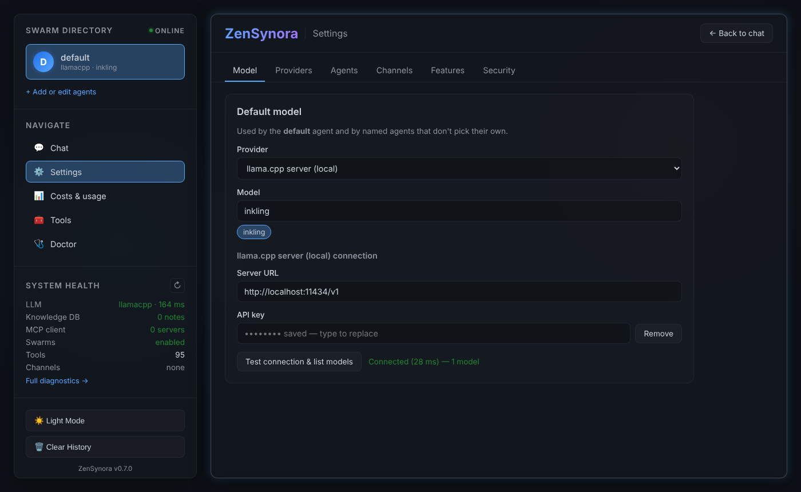
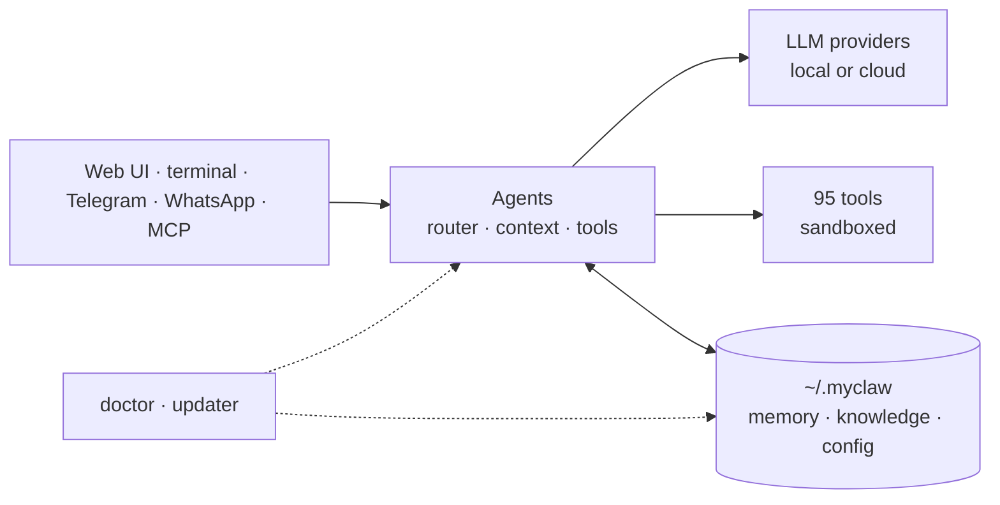

<div align="center">

# ZenSynora

**A private, self-hosted AI agent that runs on your own models.**

Chat in the browser, the terminal, Telegram or WhatsApp. ZenSynora remembers
your conversations, builds a personal knowledge base, uses 95 tools, and can
split work across teams of agents — with a local model like llama.cpp or
Ollama, or any major cloud provider.

[](CHANGELOG.md)
[](#requirements)
[](#development)
[](LICENSE)

[Quick start](#quick-start) · [Using it](#using-zensynora) · [Updating](#updating-and-health) ·
[Configuration](#configuration) · [Architecture](#architecture) · [Docs](docs/README.md)

</div>



## Why ZenSynora

- **Your models, your data.** Works fully offline with llama.cpp, Ollama or
  LM Studio. Cloud providers (OpenAI, Anthropic, Gemini, Groq, OpenRouter) are
  optional. Everything is stored locally in `~/.myclaw`.
- **Remembers.** Conversation memory per user, plus a Markdown knowledge base
  with full-text search and a knowledge graph the agents read and write.
- **Does things.** 95 tools: files, sandboxed shell, web and headless browser,
  scheduling, knowledge, delegation, and tools the agent writes for itself.
- **Works in teams.** 137 ready-made agent profiles and swarms (parallel,
  sequential, hierarchical, voting).
- **Easy to run.** A web UI with chat, settings, cost tracking and a built-in
  doctor; updates that back up your data first and roll back on failure.

## Quick start

### Requirements

- Linux (or WSL2) or macOS · Python **3.11+** (3.14 tested) · ~2 GB free disk
- A model: a local server (llama.cpp, Ollama, LM Studio) **or** a cloud API key
- Node.js is optional (only to rebuild the web UI)

### Install

```bash
curl -fsSL https://raw.githubusercontent.com/adrianx26/zensynora/main/install-online.sh | bash
```

This installs into `~/.local/share/zensynora/source` with its own virtual
environment. If ZenSynora is already installed, the same command performs a
[safe update](#updating-and-health) instead.

Prefer to look first? Clone and run the installer yourself:

```bash
git clone https://github.com/adrianx26/zensynora.git && cd zensynora
bash install.sh --no-docker        # --help for all options (Docker, dry-run, …)
```

### Start

```bash
source ~/.local/share/zensynora/source/venv/bin/activate
zensynora webui                     # open http://localhost:8000
```

Then open **Settings → Model**, pick your provider, click **Test connection &
list models**, choose a model and save. (Or run `zensynora onboard` for a
terminal wizard.)

> **llama.cpp tip:** start `llama-server` with `--jinja` so agents can use
> tools; use provider `llamacpp` with the server's `/v1` URL.

## Using ZenSynora

| Command | What it does |
|---|---|
| `zensynora webui [--port 8000] [--host 127.0.0.1]` | Web UI: chat, settings, doctor, costs, tools (`--host 127.0.0.1` = this computer only) |
| `zensynora agent` | Chat in the terminal (`@name` to address an agent) |
| `zensynora gateway` | Run the Telegram or WhatsApp bot (falls back to terminal chat) |
| `zensynora mcp-server` | Expose ZenSynora's tools to MCP clients over stdio |
| `zensynora knowledge sync \| search \| list \| read \| write` | Manage the knowledge base |
| `zensynora swarm …` · `skills …` · `memory …` | Swarms, tools/skills, conversation memory |
| `zensynora doctor` | Health check with fix hints (`--fix`, `--offline`, `--json`) |
| `zensynora update` | Safe update (`status --check`, `rollback`, `backup`) |
| `zensynora version` | Installed version and location |

Run `zensynora --help` for the full list.

**Background service:** answer *yes* to the systemd question in `install.sh`,
then `sudo systemctl start myclaw` and `journalctl -u myclaw -f`.

**Uninstall:** `bash ~/.local/share/zensynora/source/uninstall.sh` asks before
removing anything. Your data in `~/.myclaw` is only deleted when you confirm it
(or pass `--purge` together with `--yes`); `--dry-run` shows what would happen.

## Updating and health

```bash
zensynora update                  # newest version from GitHub
zensynora update status --check   # installed vs. latest
zensynora update rollback         # back to the previous version
zensynora doctor --fix            # check everything, repair safe issues
```

Updates never overwrite a working install. The new version is built next to
the current one, checked against **your** configuration, and switched in
atomically after `~/.myclaw` is backed up; any failure rolls back
automatically. Details: [docs/UPDATING.md](docs/UPDATING.md).

The doctor checks packages and provider libraries, your settings, the model
server and model, databases, permissions, code integrity and recent errors —
also available as the **Doctor** page in the web UI.
Details: [docs/medic_agent_guide.md](docs/medic_agent_guide.md).


## Configuration

The easiest way is **Web UI → Settings** (model, providers and API keys,
agents, channels, features, security). Everything is stored in
`~/.myclaw/config.json`; API keys are never sent back to the browser, and
settings are only reachable from the same computer unless you set an admin
API key.

| Provider | Setting | Notes |
|---|---|---|
| llama.cpp | `llamacpp`, `http://localhost:8080/v1` | start with `--jinja` for tools |
| Ollama | `ollama`, `http://localhost:11434` | the model must be pulled |
| LM Studio | `lmstudio`, `http://localhost:1234/v1` | |
| OpenAI · Groq · OpenRouter | API key | OpenAI-compatible |
| Anthropic · Gemini | API key | install `anthropic` / `google-generativeai` |

Environment variables override the file — useful for Docker and services:

```bash
MYCLAW_DEFAULT_PROVIDER=llamacpp
MYCLAW_DEFAULT_MODEL=qwen2.5-7b-instruct
MYCLAW_LLAMACPP_BASE_URL=http://localhost:8080/v1
MYCLAW_OPENAI_API_KEY=sk-...
MYCLAW_TELEGRAM_TOKEN=...
MYCLAW_LOG_FILE=off                 # disable ~/.myclaw/logs/zensynora.log
```

All supported variables are listed in [.env.example](.env.example).
Model advice per hardware: [docs/llm_recommendations.md](docs/llm_recommendations.md).

## Architecture



| Area | Where |
|---|---|
| Agents and the request pipeline | `myclaw/agent.py`, `myclaw/agent_internals/` |
| LLM providers, fallback, circuit breaker | `myclaw/provider.py`, `myclaw/offline.py`, `myclaw/resilience/` |
| Tools | `myclaw/tools/` |
| Memory and knowledge | `myclaw/memory.py`, `myclaw/knowledge/` |
| Swarms and agent profiles | `myclaw/swarm/`, `myclaw/agents/data/agents.yaml` |
| Web UI backend / front end | `myclaw/web/`, `webui/` |
| Doctor and medic | `myclaw/doctor/`, `myclaw/agents/medic_agent.py` |
| Safe updater | `updater/`, `update.sh` |

Diagrams of every major flow: [docs/architecture_diagram.md](docs/architecture_diagram.md) ·
module reference: [docs/ARCHITECTURE.md](docs/ARCHITECTURE.md).

## Other ways to run

- **Docker:** `bash install.sh --docker` (Compose profiles: `default`, `full`, `redis`, `ollama`).
  Data lives in `./data`; the image is built with your user ID so it stays writable.
- **Portable (USB drive):** `install_and_run_portable.sh` / `.bat` keep code
  (in `app/` or next to the script), venv and data (`data/.myclaw`) together on the drive.
- **Manual venv:** `python3 -m venv venv && venv/bin/pip install -r requirements.txt -e .`

## Development

```bash
git clone https://github.com/adrianx26/zensynora.git && cd zensynora
python3 -m venv .venv && source .venv/bin/activate
pip install -e ".[dev]"
pytest -q -o addopts=""        # 488 tests
ruff check .
```

Where to add a tool, a health check, a data migration or a web page:
[CONTRIBUTING.md](CONTRIBUTING.md). Release notes: [CHANGELOG.md](CHANGELOG.md).
All documentation: [docs/README.md](docs/README.md).

## License

AGPL-3.0 — see [LICENSE](LICENSE). Commercial licensing is available on request.
Created by **Adrian Petrescu** · [github.com/adrianx26](https://github.com/adrianx26)
