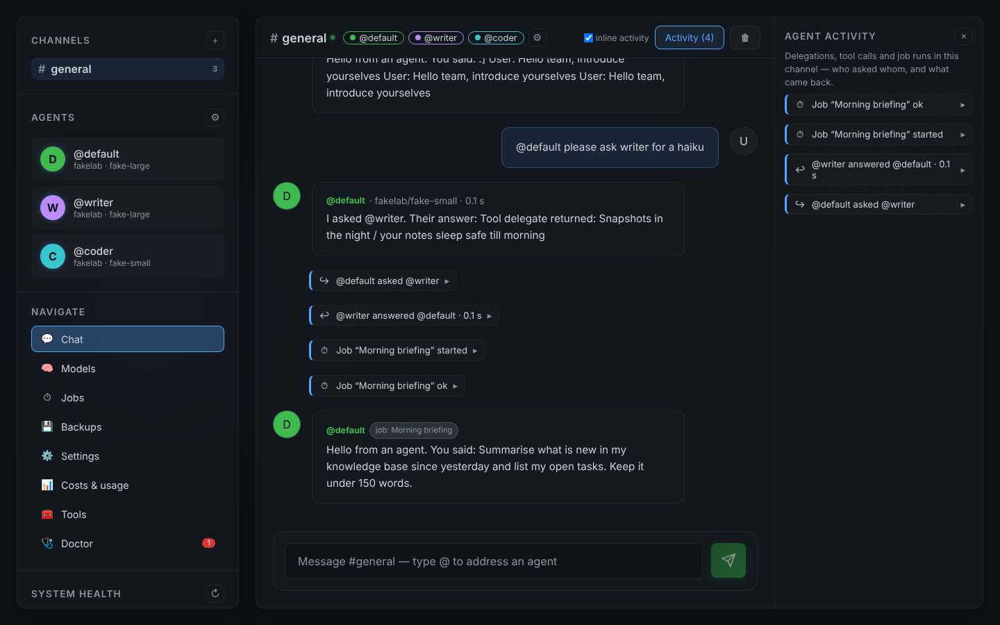
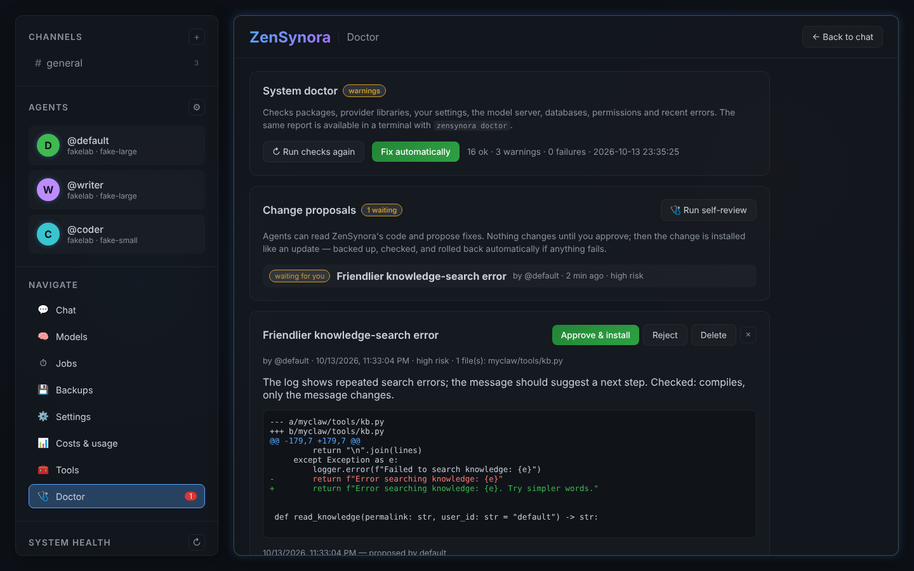
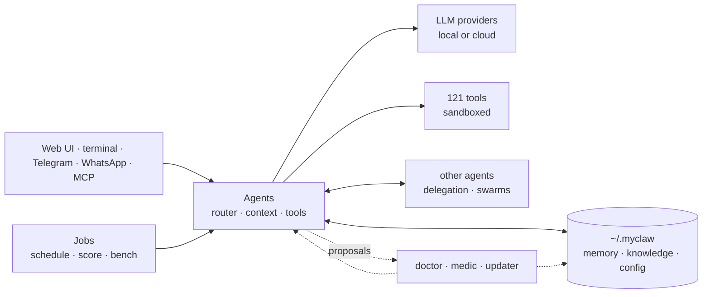

<div align="center">

# ZenSynora

**A private, self-hosted AI agent that runs on your own models.**

Chat in the browser, the terminal, Telegram or WhatsApp. ZenSynora remembers
your conversations, builds a personal knowledge base, uses 121 tools, and can
split work across teams of agents — with a local model like llama.cpp or
Ollama, or any major cloud provider.

[](CHANGELOG.md)
[](#requirements)
[](#development)
[](LICENSE)

[Quick start](#quick-start) · [Using it](#using-zensynora) · [Updating](#updating-and-health) ·
[Configuration](#configuration) · [Architecture](#architecture) · [Docs](docs/README.md)

</div>



## Why ZenSynora

- **Your models, your data.** Works fully offline with llama.cpp, Ollama or
  LM Studio. Cloud providers (OpenAI, Anthropic, Gemini, Groq, OpenRouter) are
  optional. Everything is stored locally in `~/.myclaw`.
- **Remembers.** Conversation memory per user, plus a Markdown knowledge base
  the agents read and write: notes with tags, facts and links, a live graph in
  the Web UI, search by words or (optionally) by meaning, flags for
  contradicting facts, and imports of web pages, GitHub repos, documents and
  ChatGPT/Claude/Obsidian exports. [More below](#knowledge-base).
- **Does things.** 121 tools: files, sandboxed shell, web and headless browser,
  scheduling, knowledge, delegation, and tools the agent writes for itself.
- **Works in teams.** Chat channels with several agents at once — see who
  delegates what to whom. 137 ready-made agent profiles and swarms
  (parallel, sequential, hierarchical, voting).
- **Any model, switchable.** Change the default model in one click, rotate
  or fall back across models, add your own local or online providers.
- **Runs jobs.** Scheduled or on-demand tasks with history, scoring and
  model benchmarks — created by you or by the agents themselves.
- **Safe to run and to change.** Backups of settings, API keys and knowledge;
  updates that back up the whole install and roll back on failure; agents
  can propose fixes to their own code — installed only when you approve.

## Quick start

### Requirements

- Linux (or WSL2) or macOS · Python **3.11+** (3.14 tested) · ~2 GB free disk
- A model: a local server (llama.cpp, Ollama, LM Studio) **or** a cloud API key
- Node.js 20.19+ to build the web UI — installed automatically (Node.js 22,
  no sudo) by the installer and updater when it is missing

### Install

```bash
curl -fsSL https://raw.githubusercontent.com/adrianx26/zensynora/main/install-online.sh | bash
```

This installs into `~/.local/share/zensynora/source` with its own virtual
environment. If ZenSynora is already installed, the same command performs a
[safe update](#updating-and-health) instead.

Prefer to look first? Clone and run the installer yourself:

```bash
git clone https://github.com/adrianx26/zensynora.git && cd zensynora
bash install.sh --no-docker        # --help for all options (Docker, dry-run, …)
```

### Start

```bash
source ~/.local/share/zensynora/source/venv/bin/activate
zensynora webui                     # open http://localhost:8000
```

Then open **Models**, pick your provider and a model and click *Make
default* (or run `zensynora onboard` for a terminal wizard). Chat in
`#general`, or click an agent for a private conversation. Agents hand work to
each other, can create new specialist agents, and load **skills** (instructions
for a kind of task, Skills page) when a task needs them. Tour of the pages:
[docs/webui_guide.md](docs/webui_guide.md).

**Telegram:** paste a bot token in Settings → Channels and the Web UI runs your
Telegram bot too — chat with your agents from your phone, with the same
knowledge base. Step by step: [docs/telegram_guide.md](docs/telegram_guide.md).

> **llama.cpp tip:** start `llama-server` with `--jinja` so agents can use
> tools; use provider `llamacpp` with the server's `/v1` URL.

## Using ZenSynora

| Command | What it does |
|---|---|
| `zensynora webui [--port 8000] [--host 127.0.0.1]` | Web UI: chat channels, models, jobs, backups, settings, doctor (`--host 127.0.0.1` = this computer only); also runs the Telegram bot when it is switched on |
| `zensynora agent` | Chat in the terminal (`@name` to address an agent) |
| `zensynora gateway` | Run the Telegram or WhatsApp bot without the Web UI (falls back to terminal chat) — [Telegram guide](docs/telegram_guide.md) |
| `zensynora mcp-server` | Expose ZenSynora's tools to MCP clients over stdio |
| `zensynora knowledge sync \| search \| list \| read \| write \| import \| assimilate \| embed \| distill` | Manage the knowledge base (`--base NAME` for another base) — [guide](docs/knowledge_base_guide.md) |
| `zensynora swarm …` · `skills list [--tools]` · `memory …` | Swarms, agent skills (and tools), conversation memory |
| `zensynora doctor` | Health check with fix hints (`--fix`, `--offline`, `--json`); `--report [PATH]` writes a diagnostics report (Markdown, `.json` or `.zip`, no secrets) |
| `zensynora backup create \| list \| restore` | Back up / restore settings, API keys, knowledge, conversations, jobs |
| `zensynora medic proposals \| show \| approve` | Review code changes proposed by agents |
| `zensynora update` | Safe update (`status --check`, `rollback`, `backup`) |
| `zensynora version` | Installed version and location |

Run `zensynora --help` for the full list.

**Background service:** answer *yes* to the systemd question in `install.sh`,
then `sudo systemctl start myclaw` and `journalctl -u myclaw -f`.

**Uninstall:** `bash ~/.local/share/zensynora/source/uninstall.sh` asks before
removing anything. Your data in `~/.myclaw` is only deleted when you confirm it
(or pass `--purge` together with `--yes`); `--dry-run` shows what would happen.

## Knowledge base

Notes are plain Markdown files in `~/.myclaw/knowledge/default/` — edit them
with any editor or Obsidian; the search index is rebuilt from them. Agents
search it before answering and save what is worth keeping.

- **Notes, facts, links:** frontmatter (tags, aliases, any metadata),
  `- [category] fact (source: …)` and `- relation [[Other note]]`. Links work
  by title or alias, also to notes written later. Deleted and replaced notes
  go to `.trash/`, never erased.
- **Knowledge page:** graph, notes list, tags and categories, ⚠ contradicting
  facts (*Keep A / Keep B / Both are fine*), ⧉ duplicates with a merge
  preview, a health line.
- **Search:** `AND` / `OR` / `NOT`, `"phrases"`, `tag:name` — and, if you
  switch it on, **search by meaning** with a small model that runs on your
  computer (Settings → Features, *Install* on the Knowledge page).
- **⇪ Import:** a web page, a GitHub repository, a folder or a PDF/Word/Excel
  file becomes linked notes with a Mermaid diagram (the `assimilate` tool does
  the same for agents); ChatGPT, Claude.ai, MCP memory and Obsidian exports.
- **Optional:** *distillation* (facts with confidence, groups, a summary of
  you that agents see — each traceable to its notes) and *live re-index* of
  notes you edit by hand. Both are off by default.

Search by meaning (`fastembed`) and PDF/Word/Excel import are installed with
ZenSynora (fastembed on 64-bit x86/ARM). Optional extra: `[watch]` (live
re-index). Everything:
[docs/knowledge_base_guide.md](docs/knowledge_base_guide.md).

## Updating and health

```bash
zensynora update                  # newest version from GitHub
zensynora update status --check   # installed vs. latest
zensynora update rollback         # back to the previous version
zensynora doctor --fix            # check everything, repair safe issues
```

Or use the Web UI **Updates** page (v0.7.4): check, update with live
progress, roll back, and **Restart** into the new version with one click.
After a terminal update, click *Restart now* in the Web UI banner (or restart
`zensynora webui`); a terminal opened before the update switches to the new
version by itself.

Updates never overwrite a working install. Your data **and the whole
installed program folder** are backed up first; the new version is built
next to the current one, checked against **your** configuration and switched
in atomically; settings, API keys and knowledge are verified afterwards. Any
failure restores the previous install exactly as it was. Details:
[docs/UPDATING.md](docs/UPDATING.md).

For your own backups use the Web UI **Backups** page (manual or automatic)
or `zensynora backup create`.

The doctor checks packages and provider libraries, your settings, the model
server and model, databases, permissions, code integrity and recent errors —
also available as the **Doctor** page in the web UI. There, **Change
proposals** shows fixes that agents propose for ZenSynora's own code (the
medic's self-review looks at recent errors and failed jobs): you read the
diff and approve or reject; approved changes are installed through the safe
updater and can be rolled back.
Details: [docs/medic_agent_guide.md](docs/medic_agent_guide.md).



## Configuration

The easiest way is the Web UI: **Models** (default model, rotation, your own
providers) and **Settings** (built-in providers and API keys, agents with
✨ prompt generation, channels such as the Telegram bot, features, security). Everything is stored in
`~/.myclaw/config.json`; API keys are never sent back to the browser, and
settings are only reachable from the same computer unless you set an admin
API key.

| Provider | Setting | Notes |
|---|---|---|
| llama.cpp | `llamacpp`, `http://localhost:8080/v1` | start with `--jinja` for tools |
| Ollama | `ollama`, `http://localhost:11434` | the model must be pulled |
| LM Studio | `lmstudio`, `http://localhost:1234/v1` | |
| OpenAI · Groq · OpenRouter | API key | OpenAI-compatible |
| Anthropic · Gemini | API key | install `anthropic` / `google-generativeai` |
| **Your own** (Models → Add provider) | URL (+ key) | any OpenAI-compatible server or another Ollama; presets for vLLM, LocalAI, DeepSeek, Mistral, Cerebras, GitHub Models … |

A provider can hold **several API keys** (Settings → Providers → Keys) and
each agent picks one; optionally the other keys are tried when one is
rate-limited — see [Several keys for one provider](docs/webui_guide.md#several-keys-for-one-provider).

Environment variables override the file — useful for Docker and services:

```bash
MYCLAW_DEFAULT_PROVIDER=llamacpp
MYCLAW_DEFAULT_MODEL=qwen2.5-7b-instruct
MYCLAW_LLAMACPP_BASE_URL=http://localhost:8080/v1
MYCLAW_OPENAI_API_KEY=sk-...
MYCLAW_TELEGRAM_TOKEN=...           # Telegram bot token from @BotFather
MYCLAW_LOG_FILE=off                 # disable ~/.myclaw/logs/zensynora.log
MYCLAW_BACKUP_DIR=/path/to/backups  # where backups go (default ~/.myclaw-backups)
```

All supported variables are listed in [.env.example](.env.example).
Model advice per hardware: [docs/llm_recommendations.md](docs/llm_recommendations.md).

## Architecture



| Area | Where |
|---|---|
| Agents and the request pipeline | `myclaw/agent.py`, `myclaw/agent_internals/` |
| Chat channels, agent-to-agent events | `myclaw/chat/`, `myclaw/events.py`, `myclaw/web/chat_api.py` |
| Telegram bot (in the Web UI or `zensynora gateway`) | `myclaw/channels/telegram.py`, `myclaw/web/telegram_api.py`, `myclaw/gateway.py` |
| Jobs (schedule, evaluate, benchmark) | `myclaw/jobs/`, `myclaw/web/jobs_api.py` |
| Backups | `myclaw/backup.py`, `myclaw/web/backup_api.py` |
| LLM providers, fallback, circuit breaker | `myclaw/provider.py`, `myclaw/offline.py`, `myclaw/resilience/` |
| Tools | `myclaw/tools/` |
| Memory and knowledge | `myclaw/memory.py`, `myclaw/knowledge/` |
| Swarms and agent profiles | `myclaw/swarm/`, `myclaw/agents/data/agents.yaml` |
| Web UI backend / front end | `myclaw/web/`, `webui/` |
| Doctor, medic and self-update proposals | `myclaw/doctor/`, `myclaw/agents/medic_agent.py`, `myclaw/selfupdate.py` |
| Safe updater | `updater/`, `update.sh` |

Diagrams of every major flow: [docs/architecture_diagram.md](docs/architecture_diagram.md) ·
module reference: [docs/ARCHITECTURE.md](docs/ARCHITECTURE.md).

## Other ways to run

- **Docker:** `bash install.sh --docker` (Compose profiles: `default`, `full`, `redis`, `ollama`).
  Data lives in `./data`; the image is built with your user ID so it stays writable.
- **Portable (USB drive):** `install_and_run_portable.sh` / `.bat` keep code
  (in `app/` or next to the script), venv and data (`data/.myclaw`) together on the drive.
- **Manual venv:** `python3 -m venv venv && venv/bin/pip install -r requirements.txt -e .`
  (add `-e '.[semantic,ingest,watch]'` for the optional knowledge-base features)

## Development

```bash
git clone https://github.com/adrianx26/zensynora.git && cd zensynora
python3 -m venv .venv && source .venv/bin/activate
pip install -e ".[dev]"
pytest -q -o addopts=""        # 1128 tests
ruff check .
```

Where to add a tool, a health check, a data migration or a web page:
[CONTRIBUTING.md](CONTRIBUTING.md). Release notes: [CHANGELOG.md](CHANGELOG.md).
All documentation: [docs/README.md](docs/README.md).

## License

AGPL-3.0 — see [LICENSE](LICENSE). Commercial licensing is available on request.
Created by **Adrian Petrescu** · [github.com/adrianx26](https://github.com/adrianx26)
