# ZenSynora Architecture — Visual Guide

> **Version:** 0.7.1 · **Last updated:** 2026-10-13
> 0.7.1: chat channels and agent-to-agent events (§12), jobs (§13),
> approval-gated self-update (§14), backups, model rotation and custom
> providers (§4), full program-folder backup in updates (§9).
> Unreleased: the Telegram bot can run inside the Web UI process, message
> flow through queue and workers, shared knowledge base (§1, §2, §15).
> Rewritten for 0.7.0. The previous version showed planning phases and
> modules that no longer match the code. Every diagram below reflects the
> current source tree; file names are given so you can jump to the code.
> Text-oriented companion: [ARCHITECTURE.md](ARCHITECTURE.md).

**Contents**

1. [System context](#1-system-context)
2. [Component map](#2-component-map)
3. [A chat message, end to end](#3-a-chat-message-end-to-end)
4. [Provider selection and fallback](#4-provider-selection-and-fallback)
5. [Tool execution](#5-tool-execution)
6. [Swarms](#6-swarms)
7. [Settings from the Web UI](#7-settings-from-the-web-ui)
8. [Where data lives](#8-where-data-lives)
9. [Safe updates](#9-safe-updates)
10. [Doctor and medic](#10-doctor-and-medic)
11. [Install layout on disk](#11-install-layout-on-disk)
12. [Chat channels and agent-to-agent talk](#12-chat-channels-and-agent-to-agent-talk)
13. [Jobs](#13-jobs)
14. [Self-update proposals](#14-self-update-proposals)
15. [Telegram bot](#15-telegram-bot)

---

## 1. System context

Who talks to ZenSynora, and what ZenSynora talks to.

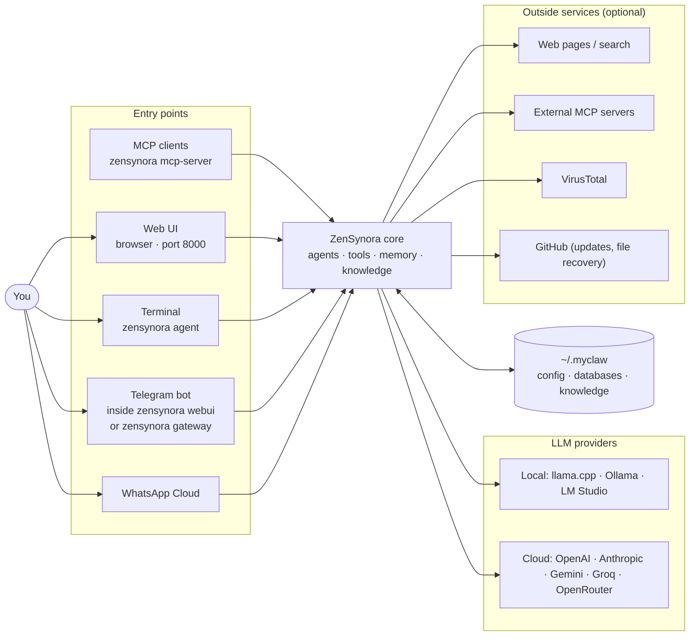

---

## 2. Component map

The main packages under `myclaw/`, grouped by layer. Arrows point from a
layer to the layer it uses.

```mermaid
flowchart TB
    subgraph L1["Interfaces"]
        direction LR
        cli2["cli.py<br/>click commands"]
        webapi["web/<br/>api · settings · models · chat · jobs · backup · medic · telegram"]
        gw["gateway.py<br/>zensynora gateway: Telegram / WhatsApp / console"]
        channels["channels/<br/>telegram · whatsapp · discord"]
        mcpsrv["mcp/server.py<br/>tools over MCP (stdio)"]
        apisrv["api_server.py<br/>REST API library (/api/v1)"]
    end

    subgraph L2["Agents"]
        direction LR
        agent["agent.py<br/>Agent: think · stream_think"]
        internals["agent_internals/<br/>router · context_builder · tool_executor"]
        swarm["swarm/<br/>orchestrator · strategies"]
        registry["agents/registry.py<br/>agents.yaml profiles"]
        special["agents/<br/>medic · newtech · skill_adapter"]
        chatx["chat/<br/>channels · multi-agent turns"]
        jobsx["jobs/<br/>store · runner · evaluate · benchmark"]
    end

    subgraph L3["Capabilities"]
        direction LR
        tools["tools/<br/>shell · files · web · browser · kb · scheduler · swarm · toolbox"]
        provider["provider.py<br/>8 built-in + your own providers · rotation"]
        events["events.py<br/>agent-to-agent activity"]
        resilience["resilience/ + offline.py<br/>circuit breaker · offline fallback"]
        prompts["prompts/ · structured_output/"]
        sandbox["sandbox.py · worker_pool.py · backends/"]
    end

    subgraph L4["State"]
        direction LR
        memory["memory.py<br/>conversation history (aiosqlite pool)"]
        knowledge["knowledge/<br/>notes · FTS5 · graph"]
        cache["semantic_cache.py · caching/"]
        vector["vector/<br/>sqlite · qdrant · memory"]
        config["config.py<br/>pydantic · hot reload"]
        stats["cost_tracker.py · metering.py · audit_log.py"]
    end

    subgraph L5["Operations"]
        direction LR
        doctor["doctor/<br/>health checks · integrity"]
        updater["updater/ (repo root)<br/>safe updates · app backup · migrations"]
        selfupd["selfupdate.py<br/>agent proposals → updater"]
        backupx["backup.py<br/>settings · keys · knowledge"]
        obs["observability/ · metrics.py · logging_config.py"]
    end

    L1 --> L2 --> L3 --> L4
    L5 -.-> L1 & L2 & L3 & L4
```

---

## 3. A chat message, end to end

What happens inside one agent when it answers (Telegram and the terminal
follow the same path from `Agent` onwards; the Telegram steps before `Agent`
are in [§15](#15-telegram-bot)). Since 0.7.1 the Web UI reaches
`Agent.stream_think` through chat channels — see [§12](#12-chat-channels-and-agent-to-agent-talk);
the per-agent socket shown here still works for scripts.

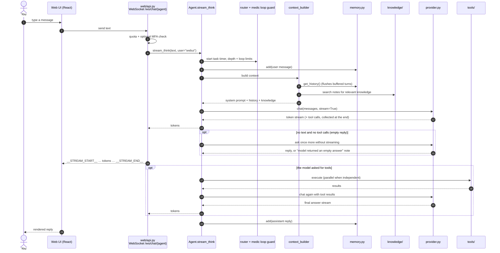

---

## 4. Provider selection, rotation and fallback

How a request reaches a model, and what happens when that fails. Changed in
0.5.0: the agent never silently switches to another provider *unless you
asked for it* — 0.7.1 adds an explicit rotation list (Models page).

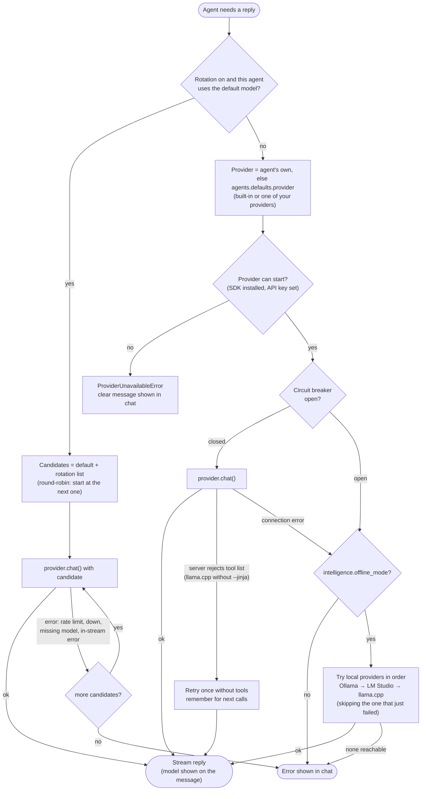

| Provider | Talks to | Python package |
|---|---|---|
| `llamacpp` | `llama-server` (OpenAI API, default `:8080/v1`) | `openai` |
| `ollama` | Ollama native API (`:11434/api/chat`) | — (httpx) |
| `lmstudio` | LM Studio (OpenAI API, `:1234/v1`) | `openai` |
| `openai`, `groq`, `openrouter` | OpenAI-compatible cloud APIs | `openai` |
| `anthropic` | Anthropic Messages API | `anthropic` (optional) |
| `gemini` | Google Gemini | `google-generativeai` (optional) |
| *your own* (`providers.custom`) | any OpenAI-compatible server, or another Ollama | `openai` / httpx |

---

## 5. Tool execution

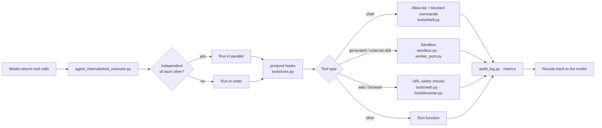

---

## 6. Swarms

A swarm splits one task across several agents (`swarm/orchestrator.py`).

---

## 7. Settings from the Web UI

Added in 0.5.0 (`web/settings_api.py`).

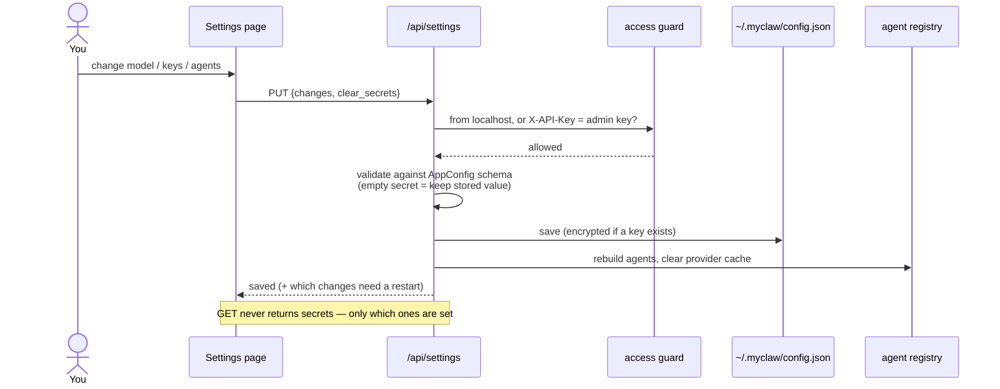

---

## 8. Where data lives

Everything personal is under `~/.myclaw`, shared by every installed version.

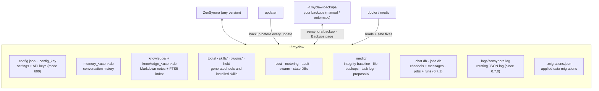

---

## 9. Safe updates

`zensynora update` (`updater/`, added in 0.6.0; program-folder backup and
data check added in 0.7.1). Steps 1–10 never touch the running version; any
failure undoes the completed steps in reverse order.

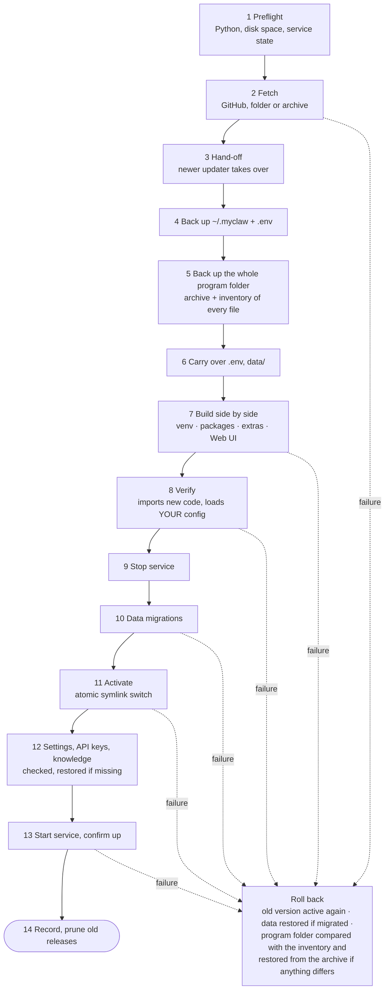

---

## 10. Doctor and medic

`zensynora doctor`, the Web UI **Doctor** page and the medic agent's tools
share one set of checks (`myclaw/doctor/`, rewritten in 0.7.0).

```mermaid
flowchart LR
    subgraph callers["Callers"]
        c1["zensynora doctor [--fix]"]
        c2["Web UI → Doctor"]
        c3["Medic tools<br/>check_system_health · get_health_report"]
        c4["Gateway startup scan"]
        c5["Agent error diagnosis"]
    end
    callers --> run["run_checks()"]
    subgraph checks["Checks (doctor/checks.py)"]
        e["environment<br/>Python · packages · provider SDKs · disk · RAM · CPU"]
        cf["configuration<br/>file valid · providers · API keys"]
        l["llm (network)<br/>server reachable · model exists"]
        d["data<br/>folders · SQLite quick_check · migrations"]
        sec["security<br/>file permissions · Web UI access"]
        i["install · runtime · integrity<br/>layout · Web UI build · log errors · service · hashes"]
    end
    run --> checks --> rep["Report<br/>ok / warn / fail + how to fix"]
    rep -- "--fix" --> fx["Safe fixes<br/>folders · permissions · migrations"]

    subgraph medicx["Other medic tools"]
        m1["scan_files · verify_file_integrity · recover_file"]
        m2["create_backup · list_backups"]
        m3["validate_modification · detect_errors_in_file · check_file_virustotal"]
        m4["record_task_execution · get_task_analytics"]
        m5["prevent_infinite_loop<br/>called by the router on every step"]
        m6["read_source_file · propose_code_change ·<br/>get_recent_problems · record_lesson (0.7.1, §14)"]
    end
```

When an agent turn fails (2026-10-18), errors from the model server are told
apart from real crashes; only the latter start the medic diagnosis.

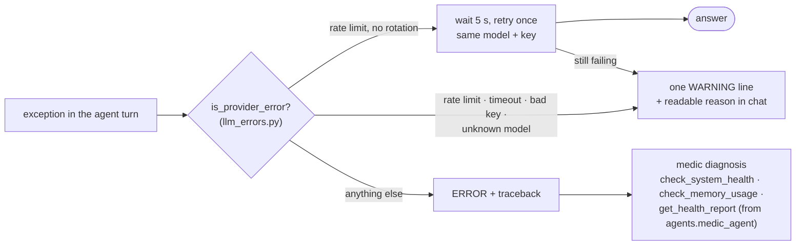

---

## 11. Install layout on disk

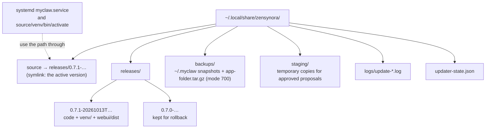

---

## 12. Chat channels and agent-to-agent talk

Added in 0.7.1 (`myclaw/chat/`, `myclaw/events.py`, `myclaw/web/chat_api.py`,
`webui/src/components/ChatView.tsx`).

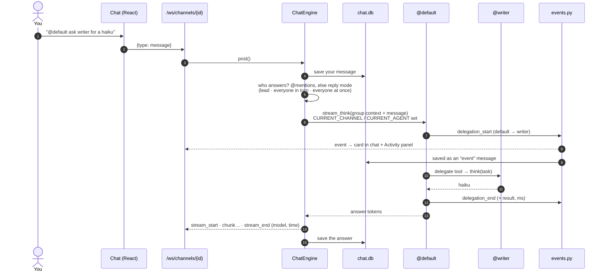

* Each `(channel, agent)` pair has its own conversation memory
  (`MEMORY_SCOPE`); the knowledge base is shared.
* Tool calls (`tool_start` / `tool_end`), swarm hand-offs and job runs travel
  the same way. Nothing is emitted when no channel is set, so the CLI,
  Telegram and tests are unaffected.

---

## 13. Jobs

Added in 0.7.1 (`myclaw/jobs/`, `myclaw/web/jobs_api.py`, Jobs page).

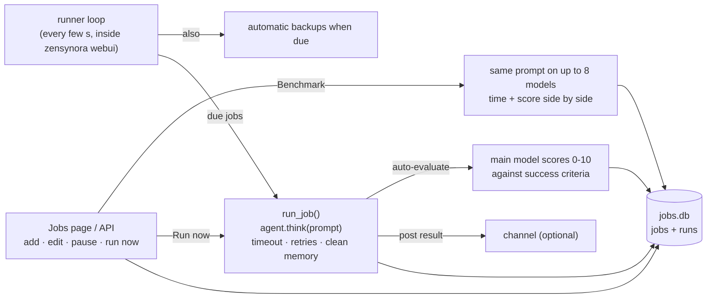

---

## 14. Self-update proposals

Added in 0.7.1 (`myclaw/selfupdate.py`, `myclaw/web/medic_api.py`, Doctor page,
`zensynora medic`). Agents never write to the program folder.

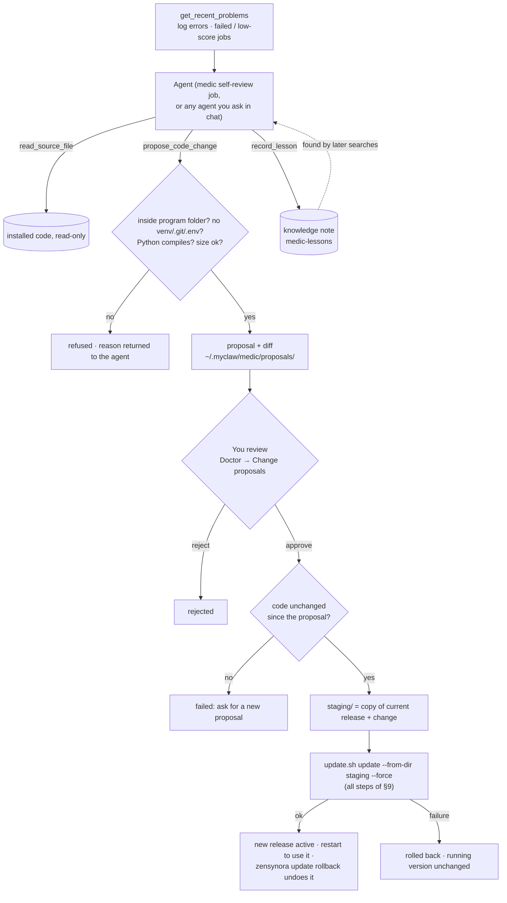

---

## 15. Telegram bot

`myclaw/channels/telegram.py`, started by `myclaw/web/telegram_api.py` (inside
`zensynora webui`) or by `myclaw/gateway.py` (`zensynora gateway`). User guide:
[telegram_guide.md](telegram_guide.md).

**Where the bot runs.** With `channels.telegram.enabled` and
`channels.telegram.run_in_webui` (default on) the Web UI process starts the
bot. `zensynora gateway` runs it without the Web UI. Telegram lets only one
copy of a bot receive messages: a second copy gets "conflict" and the Web UI
stops its own.

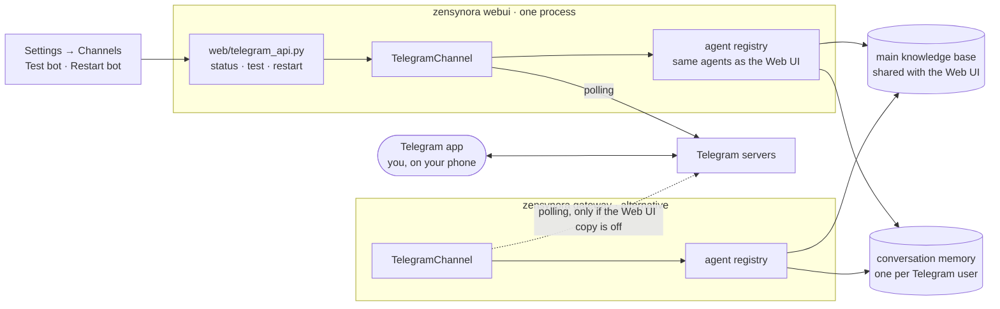

**One message, end to end.**

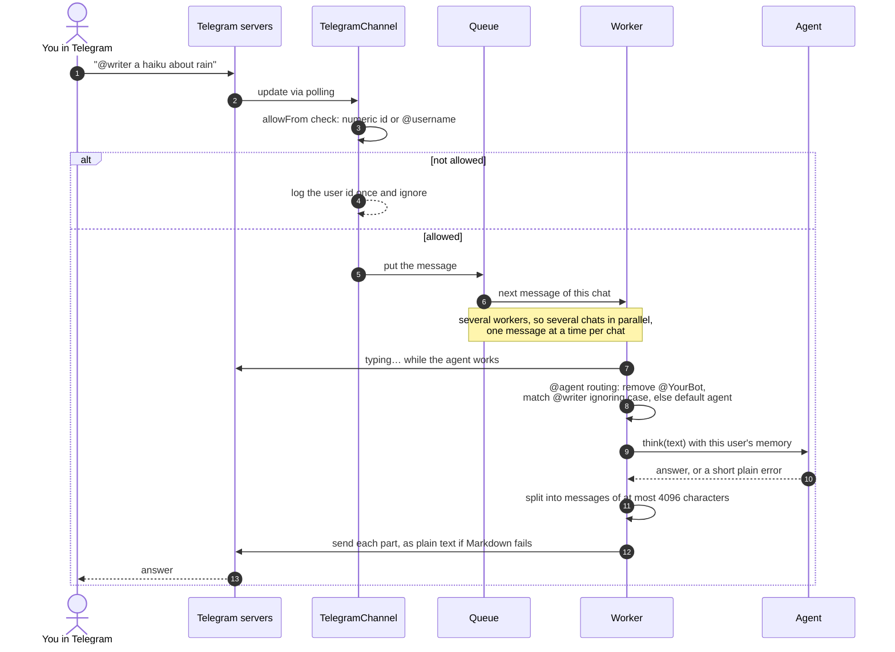

* `/start`, `/help` and `/whoami` answer everyone; all other commands need an
  allowed user.
* Photos, voice messages and documents: the caption is used as the message;
  without a caption the bot says it can only read text for now.
* Agents created later (`create_agent`, Settings) are found without a restart.
* Answers from a named agent start with `@Name: `.
* Polling is the default; `zensynora gateway --webhook-url … --port 8443`
  switches the gateway copy to webhook mode (path `/webhook`). The Web UI copy
  always polls. `ZENSYNORA_TELEGRAM_API_URL` points either copy at a
  self-hosted Bot API server.

---

*Diagrams are Mermaid; GitHub renders them directly. Standalone dark-theme
pages are generated into [`diagrams/`](../diagrams/index.html) with
`python diagrams/generate.py`.*

## 16. Providers, keys and agents

Since the Unreleased changes a provider can hold several named API keys
(`providers.<name>.keys`; the plain `api_key` is the *Default key*). Each agent,
the default model and every rotation entry pick a provider, a key and a model.
With `providers.<name>.rotate_keys` on, a rate-limited or exhausted key makes
the agent try the same model with the provider's other keys before the next
model. Cooldowns are kept per provider, model and key.

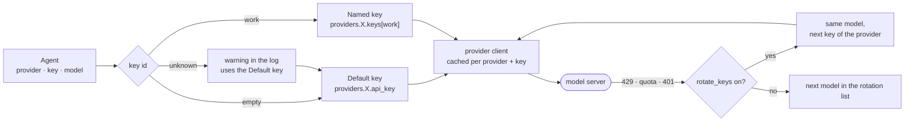

## 17. Knowledge page (Web UI)

The Knowledge page reads the Markdown notes directly (they are the source of
truth); the SQLite index is used for full-text search and is updated after
every edit. A relation whose target note does not exist becomes a "missing"
node.

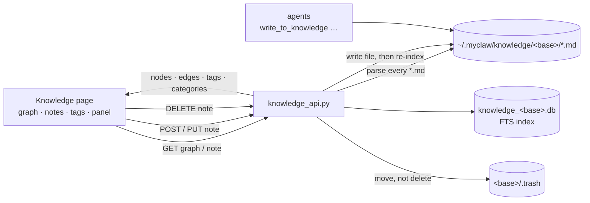

The model test on Settings → Agents uses `POST /api/models/test` (one short
real request) and colours the round-trip time: green < 1.5 s, amber < 5 s,
red above or failed.

## 18. Context length per agent

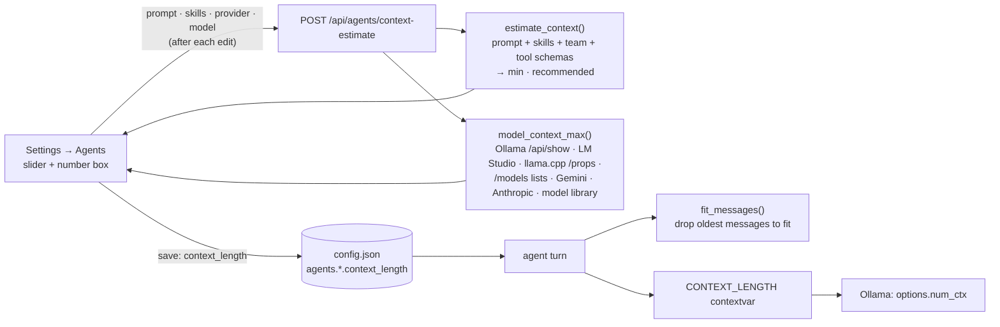

`myclaw/context_budget.py` holds all of it; token counts are estimated at
about 3.8 characters per token.

