# ZenSynora Architecture — Visual Guide

> **Version:** 0.7.0 · **Last updated:** 2026-10-13
> Rewritten for 0.7.0. The previous version showed planning phases and
> modules that no longer match the code. Every diagram below reflects the
> current source tree; file names are given so you can jump to the code.
> Text-oriented companion: [ARCHITECTURE.md](ARCHITECTURE.md).

**Contents**

1. [System context](#1-system-context)
2. [Component map](#2-component-map)
3. [A chat message, end to end](#3-a-chat-message-end-to-end)
4. [Provider selection and fallback](#4-provider-selection-and-fallback)
5. [Tool execution](#5-tool-execution)
6. [Swarms](#6-swarms)
7. [Settings from the Web UI](#7-settings-from-the-web-ui)
8. [Where data lives](#8-where-data-lives)
9. [Safe updates](#9-safe-updates)
10. [Doctor and medic](#10-doctor-and-medic)
11. [Install layout on disk](#11-install-layout-on-disk)

---

## 1. System context

Who talks to ZenSynora, and what ZenSynora talks to.

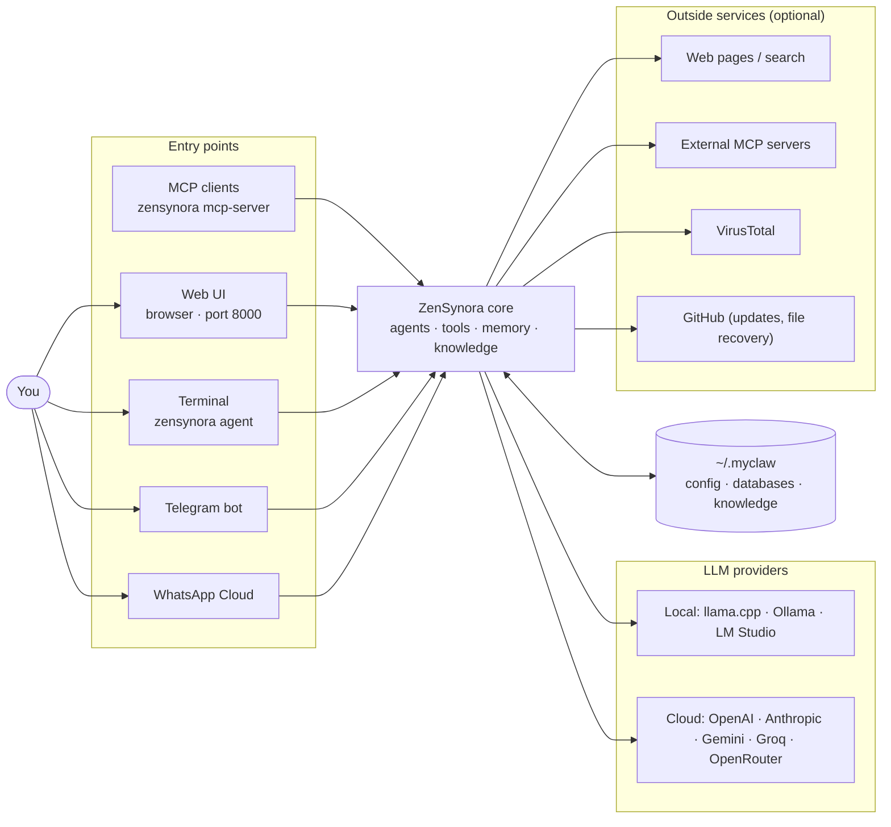

---

## 2. Component map

The main packages under `myclaw/`, grouped by layer. Arrows point from a
layer to the layer it uses.

```mermaid
flowchart TB
    subgraph L1["Interfaces"]
        direction LR
        cli2["cli.py<br/>click commands"]
        webapi["web/api.py + web/settings_api.py<br/>Web UI backend · WebSocket chat"]
        gw["gateway.py<br/>Telegram / WhatsApp / console"]
        channels["channels/<br/>telegram · whatsapp · discord"]
        mcpsrv["mcp/server.py<br/>tools over MCP (stdio)"]
        apisrv["api_server.py<br/>REST API library (/api/v1)"]
    end

    subgraph L2["Agents"]
        direction LR
        agent["agent.py<br/>Agent: think · stream_think"]
        internals["agent_internals/<br/>router · context_builder · tool_executor"]
        swarm["swarm/<br/>orchestrator · strategies"]
        registry["agents/registry.py<br/>agents.yaml profiles"]
        special["agents/<br/>medic · newtech · skill_adapter"]
    end

    subgraph L3["Capabilities"]
        direction LR
        tools["tools/<br/>shell · files · web · browser · kb · scheduler · swarm · toolbox"]
        provider["provider.py<br/>8 LLM providers"]
        resilience["resilience/ + offline.py<br/>circuit breaker · offline fallback"]
        prompts["prompts/ · structured_output/"]
        sandbox["sandbox.py · worker_pool.py · backends/"]
    end

    subgraph L4["State"]
        direction LR
        memory["memory.py<br/>conversation history (aiosqlite pool)"]
        knowledge["knowledge/<br/>notes · FTS5 · graph"]
        cache["semantic_cache.py · caching/"]
        vector["vector/<br/>sqlite · qdrant · memory"]
        config["config.py<br/>pydantic · hot reload"]
        stats["cost_tracker.py · metering.py · audit_log.py"]
    end

    subgraph L5["Operations"]
        direction LR
        doctor["doctor/<br/>health checks · integrity"]
        updater["updater/ (repo root)<br/>safe updates · migrations"]
        obs["observability/ · metrics.py · logging_config.py"]
    end

    L1 --> L2 --> L3 --> L4
    L5 -.-> L1 & L2 & L3 & L4
```

---

## 3. A chat message, end to end

What happens when you type in the Web UI (Telegram and the terminal follow
the same path from `Agent` onwards).

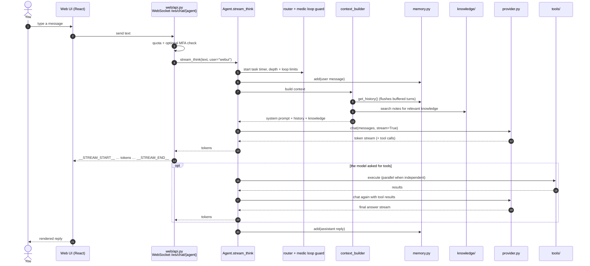

---

## 4. Provider selection and fallback

How a request reaches a model, and what happens when that fails. Changed in
0.5.0: the agent never silently switches to another provider.

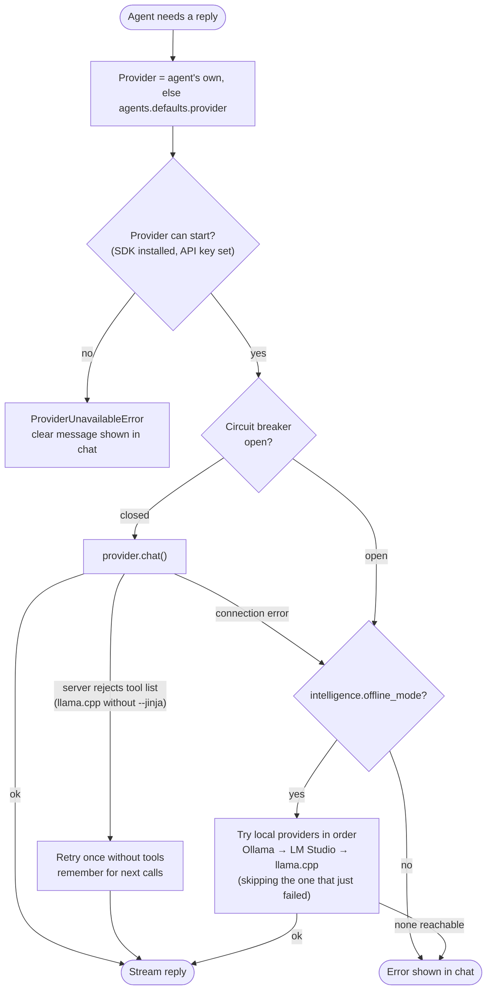

| Provider | Talks to | Python package |
|---|---|---|
| `llamacpp` | `llama-server` (OpenAI API, default `:8080/v1`) | `openai` |
| `ollama` | Ollama native API (`:11434/api/chat`) | — (httpx) |
| `lmstudio` | LM Studio (OpenAI API, `:1234/v1`) | `openai` |
| `openai`, `groq`, `openrouter` | OpenAI-compatible cloud APIs | `openai` |
| `anthropic` | Anthropic Messages API | `anthropic` (optional) |
| `gemini` | Google Gemini | `google-generativeai` (optional) |

---

## 5. Tool execution

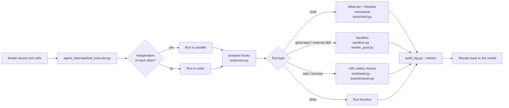

---

## 6. Swarms

A swarm splits one task across several agents (`swarm/orchestrator.py`).

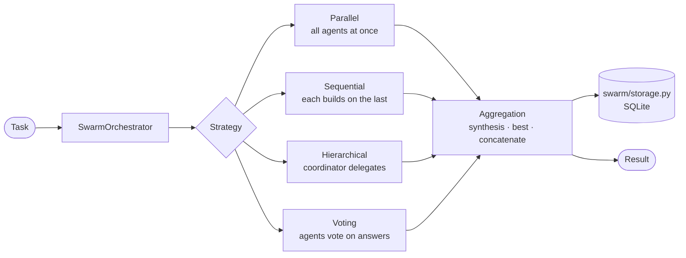

---

## 7. Settings from the Web UI

Added in 0.5.0 (`web/settings_api.py`).

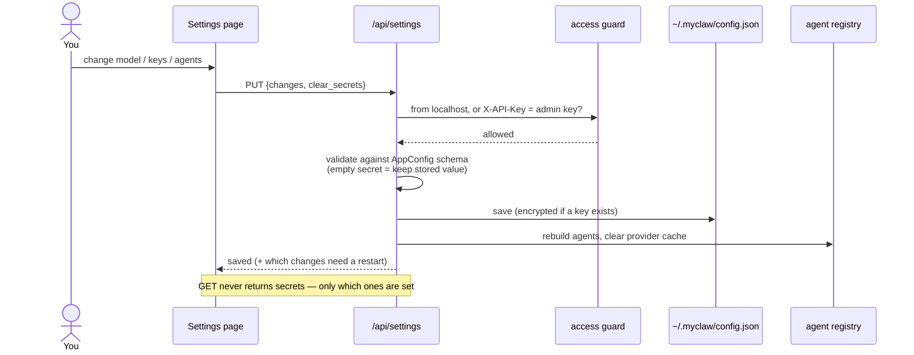

---

## 8. Where data lives

Everything personal is under `~/.myclaw`, shared by every installed version.

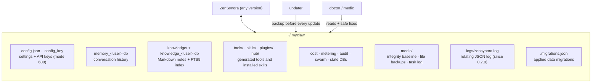

---

## 9. Safe updates

`zensynora update` (`updater/`, added in 0.6.0). Steps 1–9 never touch the
running version; any failure undoes the completed steps in reverse order.

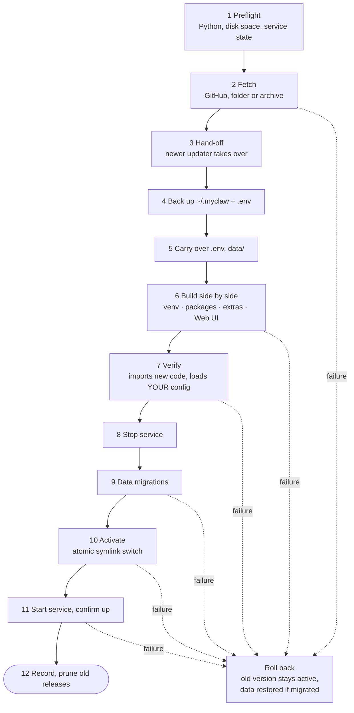

---

## 10. Doctor and medic

`zensynora doctor`, the Web UI **Doctor** page and the medic agent's tools
share one set of checks (`myclaw/doctor/`, rewritten in 0.7.0).

```mermaid
flowchart LR
    subgraph callers["Callers"]
        c1["zensynora doctor [--fix]"]
        c2["Web UI → Doctor"]
        c3["Medic tools<br/>check_system_health · get_health_report"]
        c4["Gateway startup scan"]
        c5["Agent error diagnosis"]
    end
    callers --> run["run_checks()"]
    subgraph checks["Checks (doctor/checks.py)"]
        e["environment<br/>Python · packages · provider SDKs · disk · RAM · CPU"]
        cf["configuration<br/>file valid · providers · API keys"]
        l["llm (network)<br/>server reachable · model exists"]
        d["data<br/>folders · SQLite quick_check · migrations"]
        sec["security<br/>file permissions · Web UI access"]
        i["install · runtime · integrity<br/>layout · Web UI build · log errors · service · hashes"]
    end
    run --> checks --> rep["Report<br/>ok / warn / fail + how to fix"]
    rep -- "--fix" --> fx["Safe fixes<br/>folders · permissions · migrations"]

    subgraph medicx["Other medic tools"]
        m1["scan_files · verify_file_integrity · recover_file"]
        m2["create_backup · list_backups"]
        m3["validate_modification · detect_errors_in_file · check_file_virustotal"]
        m4["record_task_execution · get_task_analytics"]
        m5["prevent_infinite_loop<br/>called by the router on every step"]
    end
```

---

## 11. Install layout on disk

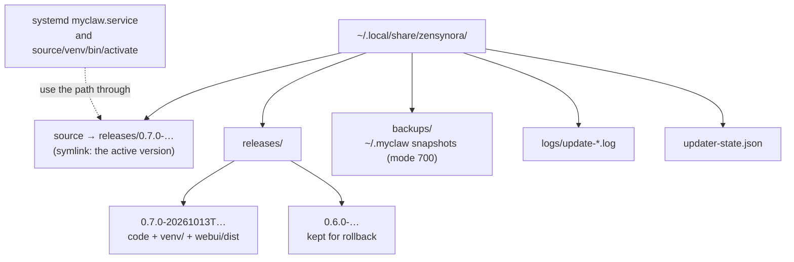

---

*Diagrams are Mermaid; GitHub renders them directly. Standalone dark-theme
pages are generated into [`diagrams/`](../diagrams/index.html) with
`python diagrams/generate.py`.*
