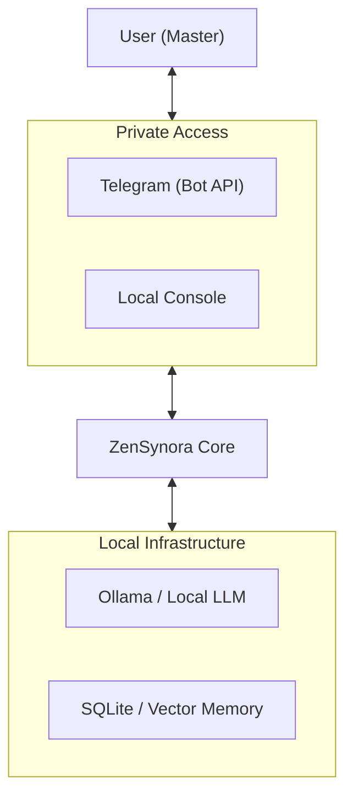
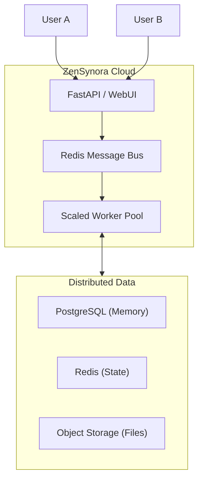

# Strategic Plan: ZenSynora Transformation

> **Archived on 2026-10-13 (v0.7.0).** Strategic plan (personal vs. enterprise variants). Kept for history; it describes the project at the time it was written and may not match the current code. Current documentation: [docs/README.md](../README.md).

## Variant A: Federated Personal Intelligence

Focus on local-first, privacy-preserving personal AI.

## Variant B: Enterprise Agent Swarm

Focus on high-scale, multi-user, multi-agent collaboration.

