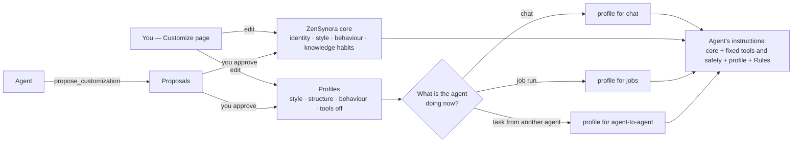

# Customize: how ZenSynora's agents work

*Since 0.8.1 (2026-11-07).* **Web UI → Customize** (🎛️ in the sidebar) is where
you decide how the agents communicate, how they lay out their answers, how they
behave and which tools they use — for every situation, and per agent. You change
it; agents can only **propose** a change, and nothing changes until you approve.
The AI can review a profile and suggest a better one, or adapt it to a new
scenario.

## The ZenSynora core

*Since 2026-11-07.* The first tab shows the **key characteristics** every agent
starts with — the default agent and every agent without its own prompt:

| Part | Built-in text (short) |
|---|---|
| **Identity** | *You are ZenSynora, a personal AI agent with access to a knowledge base, TOOLBOX, and Agent Swarms …* |
| **Communication style** | *Reply in plain text. Report errors clearly, with a suggested solution.* |
| **Behaviour** | *Verify tool outputs before proceeding; use the knowledge base; keep the context; check list_toolbox() before creating a tool.* |
| **Knowledge base habits** | *KNOWLEDGE GROWTH MANDATE: after every interaction where you share facts … save them with write_to_knowledge().* |

Edit any part and **Save**; agents get it with their next message. **Use
ZenSynora's text** puts one part back, **Reset all to built-in** the whole core,
and **↶ Undo last change** the version before (the last 20 are kept). The
identity cannot be empty. **🤖 Review and improve the core** asks the default
model for problems and better text (nothing is saved until you press Save).
Agents can propose a change to a part — `propose_customization("core",
"knowledge", "…", "why")` — which waits on the Proposals tab like any other.

**🔒 Tools and safety (fixed)** is shown below the core but cannot be edited:
how to call tools, the tool list, *never store secrets in the knowledge base*,
and that agents cannot change the Rules or the customization themselves. A
change there could break tool calling or let an agent change its own rules. To
keep an agent away from a tool, switch the tool off in a profile.

*Used by* lists the agents: those with their own prompt (Settings → Agents) or
their own profile file (`~/.myclaw/profiles/<name>.md`) use that instead of the
core; profiles and Rules still apply to them. *What an agent gets* shows the
exact text.

Until 2026-11-07 the default agent did not use this text at all: it read a
separate file in the program folder (`myclaw/profiles/default.md`) that was not
visible, was replaced by every update and lacked the parts about Rules,
customization and the knowledge base. That file is gone; its guidelines are
part of the core's *Behaviour*.

## Profiles

A **profile** has:

| Part | What you write there | Example |
|---|---|---|
| **Communication style** | Tone and wording | *Friendly and direct. Answer in Romanian. No jargon.* |
| **Response structure** | How an answer is laid out | *The answer first, then the steps. At most 10 lines.* |
| **Behaviour** | How to work | *Ask before deleting anything. Say what you are unsure of.* |
| **Tools switched off** | Tools the agent is not offered (tick them in the list) | `shell`, `ssh_command` |

The profile is a **layer on top** of the ZenSynora core and its fixed tools and
safety part, so a profile cannot break tool use. Rules come after the profile in
the prompt — they always win. A tool switched off is not sent to the model; if
an agent still names it, it gets *the tool … is switched off for you here* and
must do the task another way.

Three profiles come with ZenSynora:

| Profile | For | What it does |
|---|---|---|
| **Default** | chat and jobs | Nothing on top of the core: empty fields add nothing |
| **Agent to agent** | tasks one agent gives another | Clear, precise, minimal: no greetings, the result first, facts one per line, says what it could not do |
| **Brief** | e.g. Telegram on a phone | At most about 5 short lines, the answer first |

You can change the built-in ones (**Reset to built-in** puts back ZenSynora's
text) and create your own (**+ New profile**). Each field holds up to 10,000
characters; the counter shows how many you use — everything you write is sent
with every message, so shorter is better. Never put passwords or keys in a
profile; a field that looks like one is refused.

**Nothing is lost.** Every save keeps the previous version (the last 20 per
profile): **↶ Undo last change** puts it back. A deleted profile goes to
`~/.myclaw/.trash/customize-<name>-<time>.json`, and agents that used it go back
to *Default*. **What the agent gets** shows the exact text added to the prompt.

## Who uses what: situations and agents

ZenSynora finds out by itself what an agent is doing:

| Situation | When |
|---|---|
| **chat** | A message in a Web UI channel or on Telegram |
| **jobs** | A job run (Jobs page, schedules, agents' jobs) |
| **tasks from another agent** | The agent works on a task another agent gave it (`delegate`, swarms, a team on Telegram) |

The *Who uses what* tab has one row **All agents** (the default: Default,
Default, Agent to agent) and a row per agent where you can pick another profile
for each situation (*same as all agents* = use the row above). Changes apply to
the next message — no restart.

**Agents choose too, with your consent.** An agent can propose which profile it
uses in a situation (for example *use Agent to agent for jobs, because the lead
agent reads my results*). It appears on the Proposals tab; approving it sets
that agent's choice.

## Proposals from agents

Agents see the core and the profiles (`show_customization`) and can propose a
change with `propose_customization(profile, field, text, reason)`:

* a part of the ZenSynora core: `profile` = `core`, `field` = `identity`,
  `style`, `behavior` or `knowledge` (the tools and safety part cannot be proposed);
* a new text for `style`, `structure` or `behavior` of a profile;
* the tools switched off (`tools_off`, comma-separated);
* a new profile (give a new name as `profile`);
* which profile **they** use: `use_chat`, `use_job` or `use_agent` with the
  profile's name as text.

Nothing changes until you press **Approve** on the **Proposals** tab (the tab
shows how many wait). For a text change you see *Now* and *Proposed* side by
side. When the Telegram bot runs, you also get a short message about each new
proposal. At most 10 proposals wait at a time; the same proposal twice is
refused. Untick *Agents may propose changes* on the *Who uses what* tab to
switch proposals off.

## 🤖 Review and adapt with AI

On a profile:

* **Review and improve** — the default model (with its fallbacks) reads the
  profile and answers with a short summary, the problems it sees (unclear,
  contradictory, too long, risky) and an improved text for each part. The
  suggestions appear under the fields: **Use this** or **Use all suggestions**
  fills them in, and nothing is saved until you press **Save**.
* **Adapt** — describe a scenario (*answers on Telegram while I drive*,
  *code reviews for a junior colleague*) and the AI writes a new profile for it
  from the current one. It opens as a draft; **Create profile** saves it.

The profile text is sent to the model as information to review, never as
instructions. If no model answers, the page says why (for example rate-limited).

## Telegram: one agent or a team

The **Telegram** tab sets who answers a message without `@name`:

* **Answering agent** — any agent (the default agent unless you choose another).
* **Team members** — optional. With a team, the answering agent is the **team
  leader**: it answers you and manages the team. It plans the work, gives each
  member the part that fits it (`delegate`), checks the results and sends one
  combined answer. Members work only when the leader asks them, and then use
  their *tasks from another agent* profile (Agent to agent by default).
* A message that starts with `@Agent` always goes straight to that agent, team
  or not.

The settings are `channels.telegram.answer_agent` and `channels.telegram.team`
(see the [Telegram guide](telegram_guide.md)). Only existing agents can be
chosen; if the answering agent is deleted later, the default agent answers
again.

## Built-in features

The **Built-in features** tab shows the switches of *Settings → Features*
(knowledge base, semantic search, distillation, evaluation, doctor, …) without
leaving the page. They are the same settings.

## Where it is stored

| What | Where |
|---|---|
| The core, profiles, choices, proposals, history | `~/.myclaw/customize.json` (in backups under *Jobs, tools, skills, rules*; updates never touch it) |
| Deleted profiles | `~/.myclaw/.trash/customize-*.json` |
| Telegram answering agent and team | `~/.myclaw/config.json` → `channels.telegram` |
| Who changed what | Doctor → Logs (kind *setting*, `customize: …`) |

All changes need the Web UI (the header `X-ZenSynora-UI: 1`); an agent's shell
or a plain script cannot change them. Agents reach only the two tools above.

## API

| Route | What |
|---|---|
| `GET /api/customize` | The `core` (fields, built-in text, fixed `technical` part), `core_users`, profiles, `use`, per-agent `choices`, proposals, agents, tools |
| `PUT /api/customize/core` · `POST /api/customize/core/reset` (`{"part": …}` or `{}`) · `/core/undo` · `GET /core/preview` | Change, reset, undo the core · the full built-in prompt as agents get it |
| `POST /api/customize/profiles` · `PUT/DELETE /api/customize/profiles/{slug}` | Create, change, delete (to the trash) |
| `POST /api/customize/profiles/{slug}/reset` · `/undo` | Built-in text back · the version before the last change |
| `GET /api/customize/profiles/{slug}/preview` | The text the profile adds to a prompt |
| `PUT /api/customize/use` | `{"use": {...}, "agents": {...}, "agents_may_propose": bool}` |
| `POST /api/customize/proposals/{id}/approve` · `/reject` | Decide a proposal |
| `POST /api/customize/review` · `/adapt` | AI review (issues + improved text; `{"profile": "core"}` for the core) · a draft for a scenario; nothing saved |
