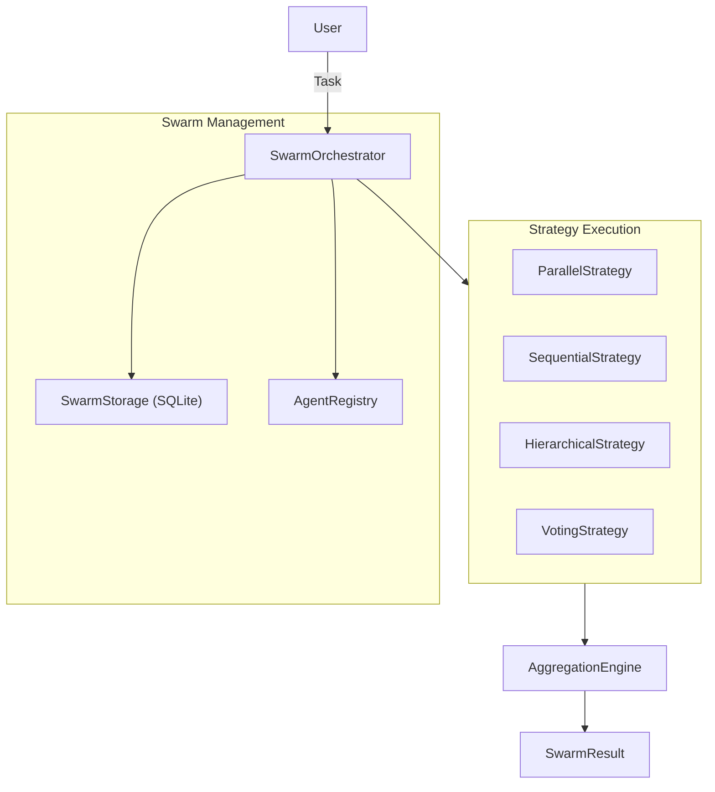
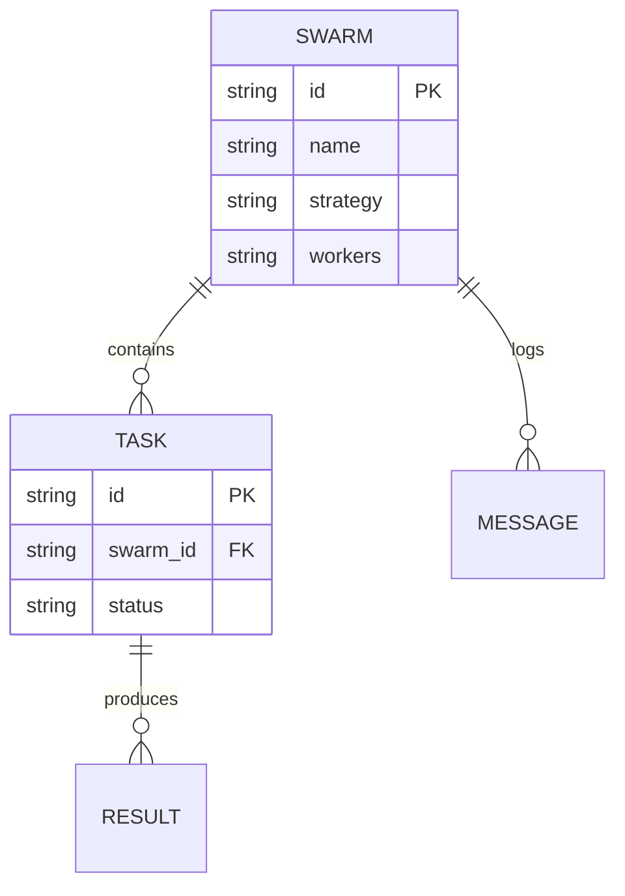

# Agent Swarm Implementation Plan

> **Developer notes — status as of 2026-10-13 (v0.7.0).** Working plan/report written during development; it may describe planned or superseded work. For current behaviour see [docs/README.md](../../README.md).

## Architecture

## Database Schema

