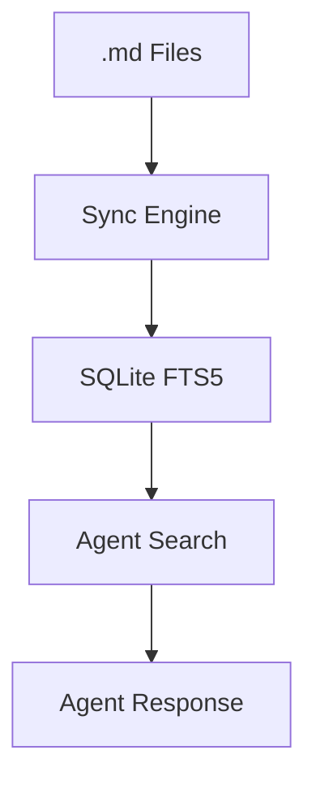

# Knowledge Integration Plan

> **Developer notes — status as of 2026-10-13 (v0.7.0).** Working plan/report written during development; it may describe planned or superseded work. For current behaviour see [docs/README.md](../../README.md).

## Overview
Integration of Markdown-first knowledge storage with SQLite FTS5 indexing.

## Diagram

## Status
- [x] Initial design
- [x] FTS5 Implementation
- [x] Relation mapping
- [x] Integration with `Agent.think()`
