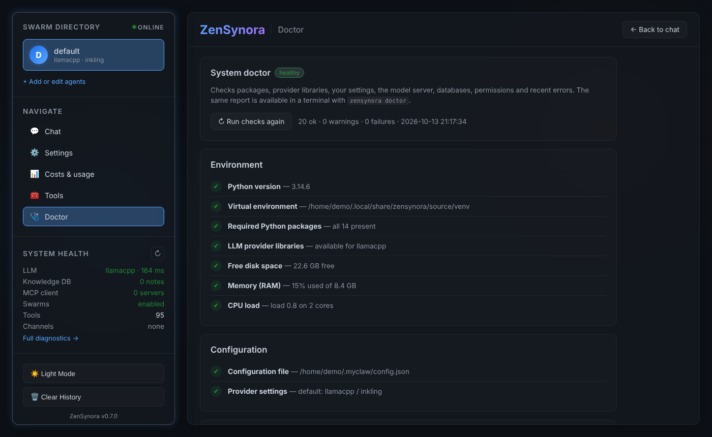
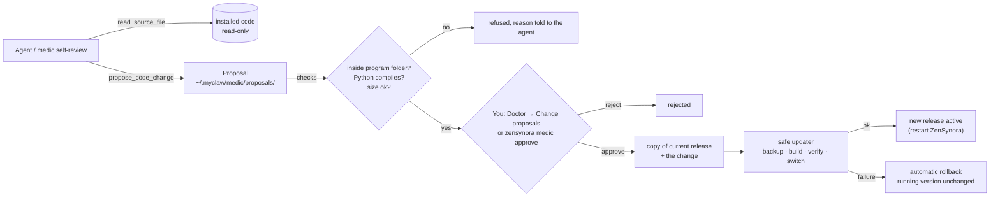

# Medic & Doctor Guide

> **Applies to:** v0.7.1 · **Rewritten:** 2026-10-13 · **v0.7.1:** self-update
> proposals and learning ([section 6](#6-self-update-proposals))
> Before 0.7.0 most medic tools described here did not exist in the code
> (two "health" tools returned fixed text). Everything below is implemented
> and covered by `tests/test_doctor_medic.py`.

The **doctor** checks your installation and tells you how to fix what's
wrong. The **medic agent** gives the AI agents the same checks as tools,
plus file-integrity protection, recovery, code validation and a guard
against runaway loops.

| You want to… | Use |
|---|---|
| Check everything from a terminal | `zensynora doctor` |
| See the same report in the browser | Web UI → **Doctor** |
| Repair safe things automatically | `zensynora doctor --fix` or **Fix automatically** |
| Get one file to understand or share a problem | `zensynora doctor --report` or Doctor → **Report** → Download |
| Let an agent check/repair itself | the medic tools below (available to every agent) |
| Let agents propose fixes to the code (you approve) | Doctor → **Change proposals**, `zensynora medic` ([section 6](#6-self-update-proposals)) |

---

## 1. The doctor

```bash
zensynora doctor              # full report
zensynora doctor --problems   # only warnings and failures
zensynora doctor --offline    # skip the model-server checks
zensynora doctor --fix        # apply safe fixes, then re-check
zensynora doctor --json       # machine-readable
zensynora doctor --report     # diagnostics report → ./zensynora-report-YYYYmmdd-HHMM.md
zensynora doctor --report ~/r.json   # .json, or .zip (report + log tail); --hours 168 = 7 days
```

Exit code: `0` healthy, `1` warnings, `2` failures — handy for scripts and
monitoring.



### What it checks

| Category | Check | Auto-fix |
|---|---|---|
| environment | Python ≥ 3.11 · running inside the venv · required packages · **provider libraries** (e.g. `openai` for llama.cpp) · free disk · RAM · CPU load | — |
| configuration | config file exists and matches the schema · providers known · API keys present for cloud providers · Telegram bot: token set, someone allowed, where it runs ([Telegram guide](telegram_guide.md)) | — |
| llm *(network)* | default model server reachable (latency) · configured model is offered by the server | — |
| data | `~/.myclaw` writable, standard folders present · every SQLite database passes `PRAGMA quick_check` · data migrations up to date · knowledge index (see below) · chat channels (see below) | folders, migrations, knowledge sync |
| security | `config.json`, `.config_key`, audit secret and update backups are owner-only · Web UI access mode | permissions |
| install | version, managed vs. legacy layout, updater present · Web UI built | — |
| runtime | errors and repeated warnings in `~/.myclaw/logs/zensynora.log` in the last 24 h · restarts (crash loop) · systemd service state | — |
| integrity | installed code matches the recorded hash baseline | — |

Safe fixes never delete anything: they create missing folders, tighten
file permissions (`600`/`700`), run pending data migrations and sync the
knowledge index.

Checks that look for trouble a running install collects:

| Check (id) | Warning / failure when… | What to do |
|---|---|---|
| Restarts (`restart_loop`) | more than 10 starts of the service (`gateway` / `webui`) in 15 minutes. **Failure** if it is still happening, **warning** if it happened earlier in the last 24 h. Short commands like `zensynora doctor` do not count. | `sudo systemctl status myclaw`, `journalctl -u myclaw -n 100` — the errors in the report are usually the cause |
| Errors in the last 24 h (`recent_errors`) | any ERROR or CRITICAL line, or a WARNING seen 5 times or more. Messages that differ only in numbers or ids count as one kind (`task_webui_123` and `task_webui_456`). **Failure** with 3 or more CRITICAL lines. | Doctor → Report → Errors shows each kind with its log lines and traceback |
| Custom tools (`custom_tools`) | an enabled tool in `~/.myclaw/TOOLBOX` holds placeholder credentials (`YOUR_…_HERE`, `YOUR_BOT_TOKEN`, `"xxx"`, `<token>`) or a hard-coded secret (Telegram token, `sk-…` key) | disable it (`disable_skill`, or `"enabled": false` in `toolbox_registry.json`) and use the built-in tools, e.g. `send_telegram_message` |
| Knowledge index (`knowledge_index`) | 3 or more note files (or more than 10 %) are not in the index, or the full-text index of note text is missing | `zensynora knowledge sync` or `zensynora doctor --fix` |
| Agent skills (`skills`) | an agent lists a skill that does not exist, or a `SKILL.md` of yours is unreadable or empty | Skills page, or Settings → Agents |
| MCP servers (`mcp_servers`) | a configured server's command is not installed (not on `PATH`) | install it (Node.js for `npx`, uv for `uvx`) or fix the command |
| Chat channels (`chat_db`) | answers left unfinished by a stop, or channel members that are no longer agents | restart the Web UI — it repairs both at start |

All of them read local files only and take well under a second.

### Diagnostics report

`zensynora doctor --report [PATH]` (or Web UI → Doctor → **Report**) writes
one file with everything needed to understand a problem:

* all doctor checks with hints;
* warnings and errors of the period, grouped (count, first/last time,
  module, message) with up to a few raw log lines and tracebacks each;
* restarts (how many, most in 15 minutes, typical gap);
* failed, timed-out or interrupted job runs, open change proposals, number of
  medic lessons;
* system (OS, Python, CPU, RAM, disk) and installation (folders, release);
* a configuration summary — which providers have a key, agents with provider
  and model, channels on/off — **never the keys or tokens themselves**;
* the last 200 log lines.

Anything in log text that looks like a token, API key or password
(Telegram tokens, `sk-…`, `AIza…`, `Bearer …`, `api_key=…`, passwords in
URLs) is replaced by `[redacted]`. Formats: Markdown (default), `.json`, and
`.zip` (report.md + report.json + `zensynora.log.tail.txt`). API:
`GET /api/doctor/report`, `GET /api/doctor/report/download?format=md|json|zip&hours=24`,
`GET /api/doctor/errors?hours=24&level=ERROR&q=text`.

### Adding a check

Checks live in `myclaw/doctor/checks.py`. One function per check:

```python
from .registry import OK, WARN, FAIL, check, fixer

@check("ollama_models", "Ollama has at least one model", "llm", network=True)
def _ollama_models(ctx):
    ...
    return WARN, "no models pulled", "Run: ollama pull llama3.2"

@fixer("ollama_models")          # optional, only for safe repairs
def _fix(ctx):
    ...
    return "pulled llama3.2"
```

Return `(status, detail, hint)`. A check that raises is reported as a
failure instead of breaking the report.

---

## 2. Medic tools (for agents)

All tools are registered in `myclaw/tools/__init__.py` and implemented in
`myclaw/agents/medic_agent.py`.

| Tool | What it does |
|---|---|
| `check_system_health(offline=False)` | One-line verdict plus every warning/failure from the doctor |
| `get_health_report(offline=False, as_json=False)` | Full doctor report |
| `check_memory_usage(threshold_percent=85)` | RAM usage, warns above the threshold |
| `scan_files(file_paths="")` | Record SHA-256 hashes of the installed code as the integrity baseline |
| `verify_file_integrity(file_path="")` | Report files modified or missing since the baseline |
| `enable_hash_check(enabled=True)` | Turn integrity checking on/off |
| `create_backup(file_path)` / `list_backups()` | Copy a file to `~/.myclaw/medic/backups/` / list copies |
| `recover_file(file_path, allow_main=False)` | Restore a file — see below |
| `detect_errors_in_file(file_path)` | Syntax check for `.py`, `.json`, `.yaml`, `.toml` |
| `validate_modification(file_path, new_content)` | Check a proposed change before writing it: syntax, size, risky calls (`eval`, `os.system`, `shell=True` …) |
| `check_file_virustotal(file_path, api_key="")` | Look up the file's SHA-256 on VirusTotal (the file is **not** uploaded) |
| `record_task_execution(task_name, success, duration_seconds, error)` | Log a task outcome |
| `get_task_analytics(days=7)` | Success rate, average duration, most-failing tasks |
| `prevent_infinite_loop(record=True)` | Runaway-loop guard status (see below) |
| `read_source_file(path, start_line, max_lines)` / `list_source_files(pattern)` | Read the installed code (read-only; never `venv/`, `.git`, `.env`) — v0.7.1 |
| `propose_code_change(title, reason, file_path, new_content, files_json)` | File a change proposal; installed only after you approve it — v0.7.1 |
| `list_change_proposals(status)` | Proposals and their status — v0.7.1 |
| `get_recent_problems(hours=24)` | Grouped log errors (incl. CRITICAL), repeated warnings, restarts / crash loop, risky custom tools, failed or low-scoring job runs, open proposals — v0.7.1 |
| `record_lesson(topic, lesson)` | Save a lesson to the knowledge note `medic-lessons` — v0.7.1 |

### Integrity and recovery

* The doctor records a baseline automatically the first time it runs and
  after every update (a new version means new reference files).
* `verify_file_integrity` compares the installed files with it.
* `recover_file` restores a file **only inside the installation folder**
  (paths like `../../etc/passwd` are refused). It first saves a copy of the
  current (possibly damaged) file, then restores:
  1. the local backup whose hash matches the baseline (the known-good copy),
     otherwise the newest local backup;
  2. otherwise the file from GitHub at the tag `v<installed version>`;
  3. from the latest `main` only if you pass `allow_main=True`.

For a whole broken installation, `zensynora update rollback` or
`zensynora update --force` is the better tool ([UPDATING.md](UPDATING.md)).

### Diagnosis after an unexpected error

When an agent turn fails with an error ZenSynora does not know, the agent
runs `check_system_health`, `check_memory_usage` and `get_health_report` and
writes the result to the log ("Medic Agent Diagnosis"); the chat answer gets
a short note. Errors that come from the model server — rate limits,
timeouts, refused keys, unknown models — are expected and only logged as one
warning with the reason (2026-10-18). A rate-limited model is retried once
after 5 s when no rotation list is set.

### Runaway-loop guard

The agent router calls `prevent_infinite_loop()` on every processing step.
If more than `medic.max_loop_iterations` steps (default **100**) happen
within one minute, further processing is refused until the rate drops —
protection against an agent that keeps calling tools or delegating forever.
Before 0.7.0 this guard imported a function that did not exist and never
triggered.

---

## 3. Configuration

`~/.myclaw/config.json` → `medic` (also editable in Web UI → Settings for
the commonly used keys):

| Key | Default | Meaning |
|---|---|---|
| `enabled` | `false` | Enables the startup scan in the gateway |
| `scan_on_startup` | `false` | Run the doctor when `zensynora gateway` starts |
| `enable_hash_check` | `true` | Integrity checking on/off (tool `enable_hash_check` overrides it) |
| `max_loop_iterations` | `100` | Steps per minute before the loop guard blocks |
| `repo_url` | `https://github.com/adrianx26/zensynora` | Source for `recover_file` from GitHub |
| `backup_dir` | `""` | Custom folder for file backups (default `~/.myclaw/medic/backups`) |
| `virustotal_api_key` | `""` | Needed by `check_file_virustotal` |

Files written by the medic: `~/.myclaw/medic/integrity.json` (baseline),
`state.json` (hash-check override), `tasks.jsonl` (analytics),
`backups/`.

Logs: since 0.7.0 ZenSynora writes a rotating JSON log to
`~/.myclaw/logs/zensynora.log` (10 MB × 5). Set `MYCLAW_LOG_FILE=off` to
disable it, or `MYCLAW_LOG_FILE=/path/file.log` to move it.

---

## 4. Log analysis, evolution and change management

The deeper medic modules are Python APIs (not LLM tools):

* `myclaw/agents/medic_evolver.py` — deterministic log analysis: pattern
  and cascade detection, a 0–100 health score and prioritised
  recommendations (`analyze_logs`, `generate_evolution_proposal`).
* `myclaw/agents/medic_change_mgmt.py` — change plans with approval,
  rollback steps, audit log, scheduled reviews and continuous monitoring
  (`create_change_plan`, `approve_change`, `execute_change`,
  `analyze_system_logs`, `start_continuous_monitoring`, …). Its log analyzer
  now reads `~/.myclaw/logs/zensynora.log` (before 0.7.0 no log file was
  written, so it never found anything).

Details: [MEDIC_CHANGE_MGMT.md](MEDIC_CHANGE_MGMT.md).

---

## 5. Troubleshooting

| Symptom | Cause / fix |
|---|---|
| `LLM server reachable: cannot reach …` | Start your model server (llama.cpp, Ollama…) and check the URL in Settings → Model. |
| `LLM provider libraries: llamacpp needs 'openai'` | `zensynora update --force` (or `pip install openai` in the venv). |
| `Configuration file: invalid` | The config doesn't match the schema; restore the last backup: `zensynora update status` → `zensynora update restore --backup NAME`. |
| `Databases: … malformed` | Restore your data from an update backup (same commands). |
| `Code integrity: N file(s) differ` | If you didn't edit them, use `recover_file` or `zensynora update --force`. |
| Loop guard blocks normal use | Raise `medic.max_loop_iterations`. |
| The chat says "the model … returned an empty answer twice" | The model server answered with nothing (overloaded free tier, a reasoning model that ran out of tokens, a model without tool support). Try again, pick another model on the **Models** page, or turn on rotation there. |
| `Errors in the last 24 h … no such column: write` | Fixed in 0.7.1 (knowledge search parsed text as FTS5 syntax). Update with `zensynora update`. |
| Delegation answers "Agent registry not initialized" | Fixed in 0.7.1. Update with `zensynora update`. |
| Log: `Medic diagnosis itself failed: cannot import name 'check_system_health'` | Fixed 2026-10-18 (the diagnosis imported the tools from the wrong place). Update. |
| Log: `cannot import name 'TaskStatus' / 'SwarmOrchestrator' from 'myclaw.tools.swarm'` or `No module named 'myclaw.tools.memory'` | Fixed 2026-10-18 (wrong imports after the tools were split into modules). Update. |
| Chat: "I needed more tool steps than allowed for one message" | Fixed 2026-10-21: the limit is now `agents.max_tool_rounds` (default 12, Settings → Features → *Tool steps per chat message*) and at the limit the agent answers with what it found — reply "continue". For jobs raise *max tool steps* (the medic suggests it). |
| Log: `… is temporarily rate-limited upstream` | The (free) model is busy. ZenSynora retries once after 5 s; add models to the rotation list on the **Models** page so another model answers. Since 2026-10-18 this no longer starts a medic diagnosis. |
| The same configuration warning many times in the log | Fixed 2026-10-18: it is logged once and again only when it changes. Remove `curl`/`wget` from Settings → Security → allowed commands if you don't need them. |

---

## 6. Self-update proposals

> Added in v0.7.1 · code: `myclaw/selfupdate.py` · tests: `tests/test_selfupdate.py`

Agents can improve ZenSynora's own code — but **never by writing to the
program folder**. They propose; you decide; the safe updater installs.



**How a proposal is checked.** Paths must stay inside the installed program
folder; `venv/`, `.git`, `node_modules`, build output, `.env` and the config
key are off limits; Python files must compile; at most 20 files of 400 KB
each; a unified diff is stored for review. Changes that touch only `.md`,
`.txt` or `.rst` files are *low risk*; everything else is *high risk*.

**How it is installed.** On approval, the current release is copied (without
`venv/`), the change is applied to the copy, and `update.sh update
--from-dir <copy> --force` runs — full data and program-folder backup,
side-by-side build, checks against your settings (and the test suite when
`medic.self_update.run_tests` is on), switch, automatic rollback on any
failure. If a file changed after the proposal was made, the install is
refused ("ask for a new proposal"). The result and the updater log are kept
with the proposal. Undo an installed change with `zensynora update rollback`.

**Commands.**

```bash
zensynora medic proposals [--status pending]
zensynora medic show ID          # reason + diff
zensynora medic approve ID       # approve and install now
zensynora medic reject ID --note "not needed"
zensynora medic apply ID         # install an approved one / retry a failed one
zensynora medic problems         # what the medic looks at
```

**Settings** (Settings → Features → *Self-update by agents*, or `config.json`):

| Setting | Default | Meaning |
|---|---|---|
| `medic.self_update.enabled` | `true` | Agents may read the code and file proposals |
| `medic.self_update.auto_approve_low_risk` | `false` | Install documentation-only proposals without asking |
| `medic.self_update.run_tests` | `false` | Run the test suite on the new release before switching (needs `pytest` in the venv) |

Self-update needs the standard install (`~/.local/share/zensynora`, made by
`install-online.sh` or `zensynora update`). Docker and portable installs can
still review proposals but install them by rebuilding / copying.

### Learning

* `get_recent_problems` groups identical errors from the log and lists
  failed or low-scoring job runs (score below 6) and open proposals.
* `record_lesson` appends to the knowledge note **medic-lessons**, so every
  agent can find past causes and fixes with a normal knowledge search; the
  Doctor page lists them.
* **Run self-review** (Doctor page) — or the *Medic self-review* job
  template, e.g. daily at 03:00 — asks the default agent to look at the
  problems, read the code involved, propose at most one small fix and record
  what it learned. The run is scored like any job, so the Jobs page shows how
  useful the reviews are. Other agents can join through the chat (for
  example `@coder review proposal …`) and by delegation.

### Troubleshooting (v0.7.2)

| Symptom | Cause / fix |
|---|---|
| The Web UI still shows the old version after `zensynora update` | The old server is still running. Stop it (Ctrl+C), start `zensynora webui` again (from 0.7.2 on, an old terminal switches to the new version by itself) and reload the page. |
| The chat shows `{"tool": "…", "args": …}` as the answer | The model writes tool calls as text. Fixed in 0.7.2 — such calls now run. |
| A job or chat ends with "[Error] … only available to specific apps" | OpenRouter refuses that model for ZenSynora. Pick another model; use **Test** on the Models page. (v0.7.3) |
| "[Error] … rate-limited" | Free models are often busy. Wait a minute or turn on rotation with a second model. (v0.7.3) |
| LM Studio answers nothing / "Unexpected endpoint" | Load a model in LM Studio; the URL needs `/v1` (added automatically since 0.7.3). |
| A job ends with "I needed more tool steps" | Raise the job's *Tool steps* (default 8), or name the website in the prompt. **🩺 Ask the medic** on the run suggests both. (v0.7.5) |
| A job keeps failing and you don't know why | **🩺 Ask the medic** on the failed run (Jobs page), or set the job's *When a run fails* to *diagnose* or *fix*. (v0.7.5) |
| A channel member can't be removed / no agent can be added ("Unknown agent") | An agent was renamed or deleted. Fixed in 0.7.5: open the Web UI once and the channel is repaired. |
