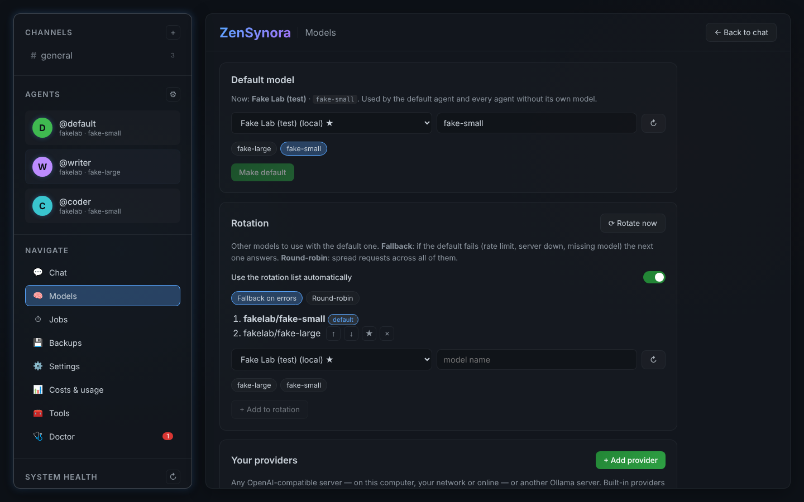
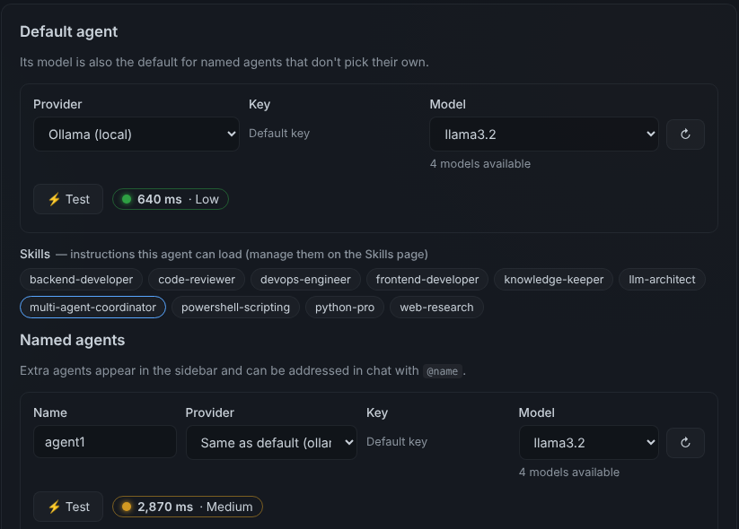
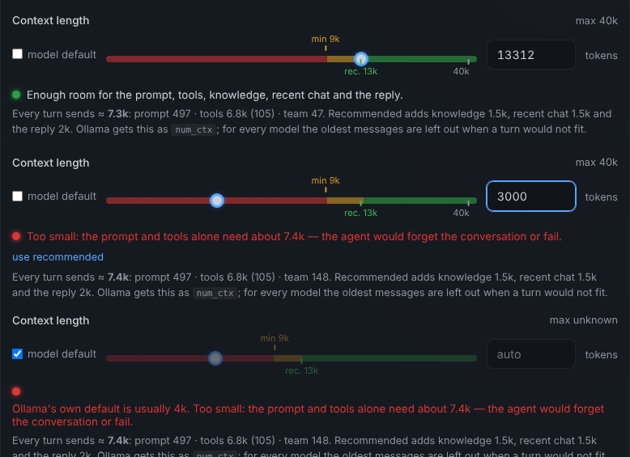
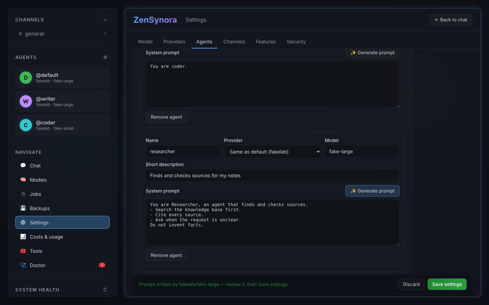
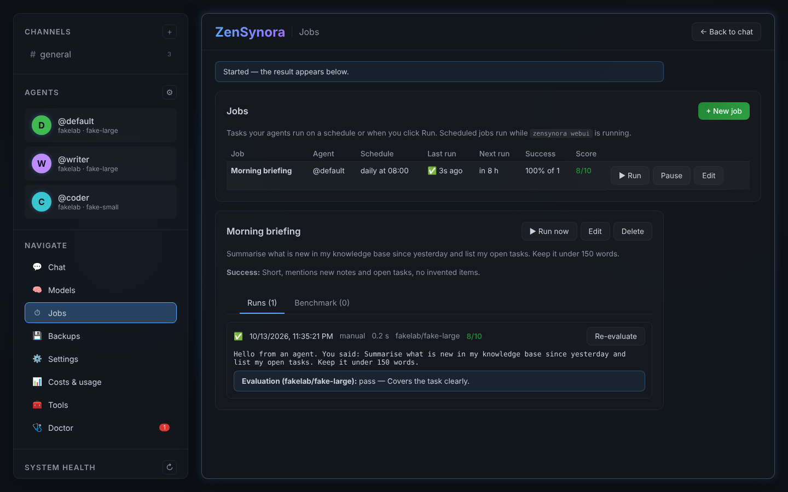
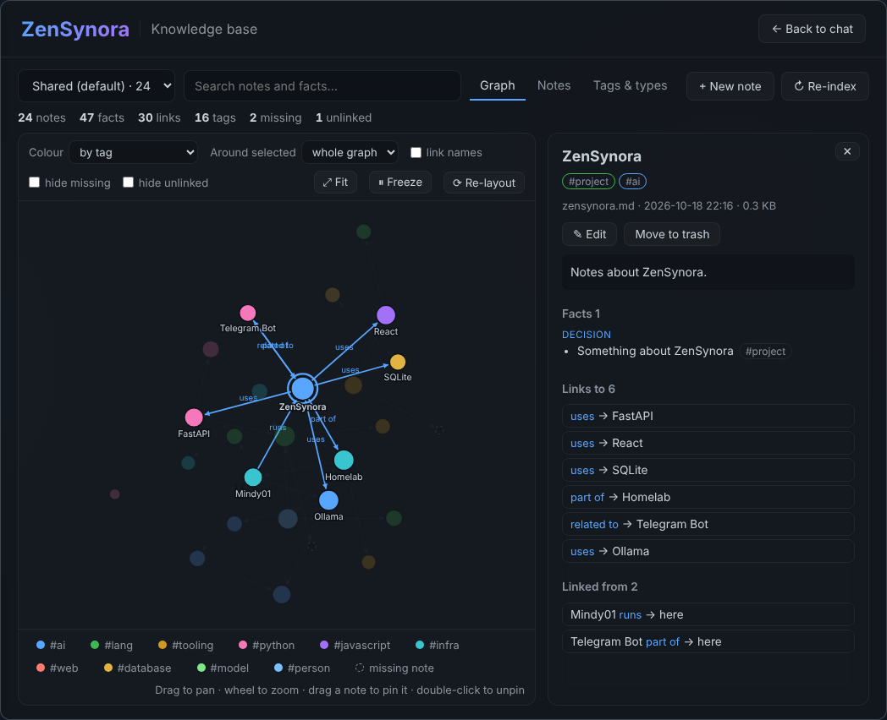
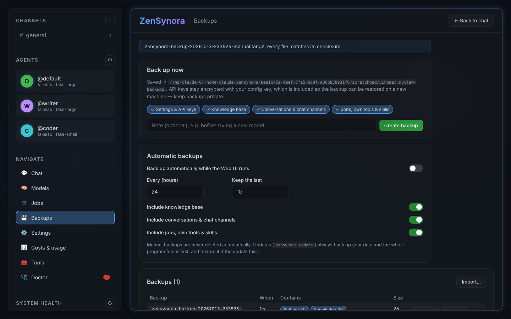

# Web UI Guide — chat, models, jobs, backups

> **Applies to:** v0.7.5 · **Added:** 2026-10-13 · **v0.7.3:** Channels page,
> real model tests · **v0.7.4:** Updates page, Restart button · **v0.7.5:**
> Skills, agents that create and delegate, medic for failed jobs, token speed
> · **Unreleased:** Telegram bot inside the Web UI (Settings → Channels)

Start the Web UI with `zensynora webui` and open <http://localhost:8000>
(`--host 127.0.0.1` keeps it on this computer only). This guide covers the
pages added in 0.7.1. Settings, Costs, Tools and Doctor are described in the
[README](../README.md) and the [Medic & Doctor guide](medic_agent_guide.md).


## Chat: channels and several agents

| Where | What it is |
|---|---|
| **Channels** (`#general`, `＋` for more) | Group rooms. Pick the members when you create one; change them with ⚙ in the channel bar. |
| **Agents** (sidebar) | Click an agent for a private conversation (direct message) with it alone. |

**Managing channels** (v0.7.3): the **Channels** page (⚙ next to *Channels*
in the sidebar) creates channels with a name, a **topic** (the agents are told
it is the channel's purpose), members and reply mode, and renames, edits,
clears or deletes them. It shows message counts and last activity, and lists
the direct-message conversations too.

**Who answers.** In a channel, `@name` addresses an agent (type `@` for a
list; an agent that is not a member yet is added), `@all` asks every
member. Without a mention the channel's *reply mode* decides:

| Reply mode | Behaviour |
|---|---|
| Lead answers | The first member answers; others only when mentioned (default) |
| Everyone, in turn | Each member answers and sees the earlier answers — good for review chains |
| Everyone, at once | All members answer in parallel — fastest, independent opinions |

**Agent-to-agent talk.** When an agent hands work to another one (the
`delegate` tool or a swarm), uses a tool, or a job posts into the channel,
you see it in the conversation. Steps that follow each other are **grouped
into one line** — *⚙ 12 steps · 2.0 s — @Executor: browse ×5 · @default asked
@Executor* — and a click shows each step (*@default asked @writer*, *@writer
answered @default · 1.2 s*, every tool call) with its task and answer. The
**Activity** panel on the right lists every step for the channel. The menu at
the top of the chat switches between *Activity: grouped* (default), *every
step* (one line per step, as before) and *hidden*; the choice is remembered in
this browser.

**Agents as a team** (v0.7.5). Every agent knows the other agents and what
they do, and hands work to them with `delegate` when another one fits better —
you see the hand-over as a card. An agent can also **create a new agent**
(`create_agent`) when a task needs a specialist nobody is; it appears in the
sidebar at once (✨ card in the channel) and can be changed or removed in
Settings → Agents. A task is handed over at most twice, so agents cannot pass
it back and forth forever. Switch creation off with
`agents.allow_agent_creation` (Settings → Features).

**Deleted agents.** When you rename an agent in Settings, its channels,
direct messages and jobs move to the new name. An agent you delete is removed
from its channels (the channel says so).

**Message actions.** Point at a message (on a phone: tap **…**) for a small
bar with the time (hover it for the full date) and these actions:

| Action | Your messages | Agent answers |
|---|---|---|
| **Copy** | Copies the text | Copies the text; each ``` code block also has its own **Copy code** button |
| **Edit** | Edit in place, **Save & send** (Enter; Esc cancels): everything after it in the channel is removed and the agents answer the edited message again (same rules, `@mentions` work) | Correct the text in place; nothing is run again |
| **Delete** | *Delete this message*, or *Delete this message and the answers to it* (up to your next message) | Deletes the answer (asks first) |
| **Regenerate** | — | The same agent writes this answer again, in the same place |

Edited messages show *(edited)*. Changes and deletions appear in every open
browser at once. While the agents are answering these actions wait: press ■
or let them finish. **↑** in the empty input edits your last message.
**⤓ MD** in the channel bar copies or downloads the conversation as
Markdown (`GET /api/channels/{id}/export.md`).

After an edit, delete or regenerate, each agent's memory of the channel is
rebuilt from the messages you see (your messages and its own answers), so it
never answers an edited question with the old one in mind. Details of earlier
tool calls are not kept in that memory.

**Good to know.**
* Under each answer: model, time and **⚡ tokens per second** (hover for the
  token count and the time to the first token; counts are estimates).
* Answers stream; ■ stops the agents. Messages you send meanwhile wait their turn.
* Enter sends, Shift+Enter starts a new line.
* Every agent keeps its own memory per channel; the knowledge base is shared.
* History lives in `~/.myclaw/chat.db` and is included in backups (*Conversations*).
* With two-factor authentication on, the chat asks for the code first.

**Tool steps per message.** An agent may call tools several times to answer
one message (search, then read, then write …). Settings → Features → *Tool
steps per chat message* (`agents.max_tool_rounds`, default 12) limits the
rounds. At the limit the agent answers with what it found so far and says
what is left — reply **continue** to let it go on. To look at the tools
themselves, an agent can call `list_tools(details=True)` (all tools with
arguments and purpose) and `get_tool_documentation(name)`.

**How long an agent may work.** Settings → Features → *Timeouts & memory* →
*Longest an agent may work on one message (s)* (`timeouts.task_seconds`,
default 600, 60–7200; it was a fixed 300 s before 2026-10-23). After that the
task is stopped and logged as a timeout. Jobs use their own *Timeout* instead.

**What agents may run in the shell.** Commands from the allow-list (Settings
→ Security → *Shell commands the agent may run*) run in
`~/.myclaw/workspace`, without a shell. Since 2026-10-23 agents may chain
allowed commands with `|`, `&&`, `||` and `;` (e.g. `ps aux | grep zensynora`
once `ps` is allowed, `pwd && ls -la`), at most 8 per call. Refused: `$`,
backticks, `\`, `{ }`, `< >`, `( )`, background `&`, new lines, and
`find -delete` / `-exec`. `read_file` lists a folder when given one and says
what is there when a file is missing.

## Models: switch, rotate, add providers



* **Default model** — pick a provider and a model (the list comes from the
  server; ↻ refreshes) and click *Make default*. The previous default is
  remembered in the rotation list, so switching back is one click (★).
* **Rotation** — extra models used together with the default one:
  * *Fallback on errors*: the default answers; if it fails (rate limit,
    server down, model missing) the next model in the list answers.
  * *Round-robin*: requests are spread over all models.
  * *Rotate now* makes the next model the default.
  Rotation applies to the default agent and to agents that use the default
  model; agents with their own model keep it. A model that was just refused,
  unknown or rate-limited is skipped for a while.
* **Test / Test all** (v0.7.3) sends a tiny real request. A model can be
  listed and still refuse to work with ZenSynora (OpenRouter answers some
  free models with "only available on agentic harnesses"), need credits or not
  be loaded — test before you rely on it.
* **Your providers** — *Add provider* for any OpenAI-compatible server
  (local: vLLM, LocalAI, Jan, KoboldCpp, text-generation-webui; online:
  DeepSeek, Mistral, Cerebras, Together, GitHub Models, Hugging Face, NVIDIA
  NIM, Gemini, xAI, Fireworks — several have free tiers) or another Ollama
  server. Presets fill the URL; add the key, *Test connection*, save. The new
  provider then appears everywhere a provider can be chosen. Keys are stored
  in `~/.myclaw/config.json` and never sent back to the browser.

### Several keys for one provider

A provider can have more than one API key — for example two free OpenRouter
accounts, or a work and a personal key.

* **Add keys.** Settings → Providers shows a **Keys** list under each
  provider (for your own providers: Models → Your providers → **Keys**).
  *+ Add key*, give it a name and paste the key. The provider's normal API
  key is the **Default key**.
* **Per key:** *Test* checks the connection with that key and lists the
  models it can use; *Edit* renames it or replaces the secret (leave the key
  field empty to keep it); *Delete* removes it. Each key shows which agents
  use it; a key in use cannot be deleted — pick another key for those agents
  first.
* **Pick a key.** Settings → Agents: *Provider*, then *Key*, then *Model*
  (↻ lists the models of that provider and key). The Models page has the same
  *Key* picker for the default model and for rotation entries. *Default key*
  means the provider's normal key; an agent that has no provider of its own
  also uses the default agent's key.
* **Use the other keys when one is limited.** Turn on *When a key hits a rate
  limit or runs out of quota, try the other keys* (shown once a provider has
  two keys). On a rate limit, missing credits or a refused key, the same model
  is tried with the provider's other keys before the next model in the
  rotation. A key that just failed is skipped for a while (per provider, model
  and key). Off by default.
* If an agent's key was deleted (for example by editing the config file), the
  agent uses the default key; the log and the Doctor warn about it.

In `config.json`:

```json
"providers": {"openrouter": {
  "api_key": "sk-or-main",
  "keys": [{"id": "work", "label": "Work account", "api_key": "sk-or-work"}],
  "rotate_keys": true}},
"agents": {"named": [{"name": "Coder", "provider": "openrouter", "model": "…", "key": "work"}]}
```

Key ids use lower-case letters, digits, `-` and `_`; `default` is reserved.

**Choosing a model and testing its speed.** Settings → Agents has a
*Provider / Key / Model* row for the default agent and for every named agent.
The *Model* list holds the models that provider (with that key) offers; it is
loaded when the tab opens, ↻ reloads it and *Other — type a name…* takes a
model the list does not show. **⚡ Test** sends one short real request and
shows how long the answer took:

| Light | Round trip | Meaning |
|---|---|---|
| 🟢 Low | under 1.5 s | quick |
| 🟡 Medium | 1.5 – 5 s | usable, slower |
| 🔴 High / Failed | over 5 s, or no answer | slow, or not working (the reason is shown) |

The first request to a local model (Ollama, LM Studio, llama.cpp) also loads
it into memory — test a second time to see the normal speed.



**Context length.** How much text (in tokens) the agent's model works with
per turn. Each agent has a slider and a number box (type `16384` or `16k`);
*model default* leaves it to the model.



* **min** (amber mark) — what the agent needs at the very least: its system
  prompt, skills list and team list, the tool definitions sent with every
  request (about 7k tokens for ZenSynora's ~105 tools), one exchange and a
  short reply. Below it the bar is red: the agent forgets the conversation or
  fails.
* **rec.** (green mark) — the minimum plus knowledge-base results, the recent
  conversation (`agents.summarization_threshold` messages) and a longer
  reply.
* **The end of the bar** is the model's own maximum, asked from the provider
  (or the model library; "max unknown" if neither knows it).

The marks are recalculated (≈ 1 s) after you write, generate or change the
prompt, or change the skills or the model. Token counts are estimates
(±20 %). The setting takes effect on save: Ollama loads the model with this
`num_ctx` (Ollama's own default is usually 4k — less than ZenSynora needs);
for every provider the oldest messages are left out when a turn would not
fit.

**Writing agent prompts.** In Settings → Agents, give a new agent a name and a
short description and click **✨ Generate prompt**: the default model writes
a system prompt (role, how to work, tools to prefer, limits). Review it and
save. If the default model is refused or busy, the rotation models are tried
in turn (v0.7.4); the message under the button names the model that wrote it.



## Jobs: scheduled and on-demand tasks



A job is an instruction an agent carries out on a schedule or when you click
**Run**. Scheduled jobs run while `zensynora webui` is running.

| Field | Meaning |
|---|---|
| Agent | Who does the work |
| Schedule | Manual, once, every N minutes, daily at HH:MM, weekly on chosen days |
| Post results in | A channel (the run and its result appear there as activity) or nowhere |
| Success criteria | What a good result looks like — used for scoring |
| Score every run | The default model scores each run 0–10 against the criteria |
| Retries / timeout | Retry failed runs; stop runs that take too long |
| Clean memory | Each run starts without the previous runs' conversation |

**When a run fails** (v0.7.5): click **🩺 Ask the medic** on the run. The
medic says what went wrong, explains it, and suggests changes to the job
(shown as *now → suggested*) and anything only you can do (start a model
server, add credits). **Apply fix & run again** changes the job and runs it;
**Ask the medic to fix the code** is offered when ZenSynora itself is at fault —
the medic reads the code and files a proposal you approve on the Doctor page.
Common failures are recognised even when no model answers. In the job's
settings, *When a run fails* can do this automatically (diagnose, or diagnose,
fix the job and run once more). **Tool steps** sets how many extra tool rounds
(search, read, retry…) the agent may use per run — raise it for research jobs.

**Agents make jobs too** (2026-10-21). Ask an agent in chat — *"check the
backups every morning at 7 and tell me here"*, *"remind me in 30 minutes"* —
and it creates the job with `job_create`; it shows up in this table with
*by agent:<name>*, and its results are posted in the channel where you asked.
Agents can also list jobs, start one (`job_run`), read how the last runs went
(`job_status`) and pause / resume jobs; only jobs they made can they change
further. Turn this off in Settings → Features → *Agents may create and change
jobs*. Repeating jobs made by agents run at most every 5 minutes.

**Monitor** in the table: running state, last and next run, success rate,
average score. **Runs** shows each run's output, model, duration and
evaluation (*Evaluate* scores a run on demand). **Benchmark** runs the same
job on up to 8 models at once and compares time and score — a quick way to
choose a model for a task. Templates: morning briefing, weekly knowledge
clean-up, medic self-review.

## Knowledge base

All agents share one knowledge base (notes in `~/.myclaw/knowledge/default`,
Markdown files you can also edit yourself — format, search syntax and CLI in
the [Knowledge base guide](knowledge_base_guide.md)). Before answering, an agent
searches it automatically; agents can also use these tools themselves:

| Tool | What it does |
|---|---|
| `search_knowledge` | Full-text search over titles, note text, tags and observations; `AND`/`OR`/`NOT`, `"phrases"`, `tag:name` |
| `read_knowledge` / `list_knowledge` | Read one note (text, facts, links, *Linked from*) / list the notes |
| `write_to_knowledge` | Save a note (title, text, tags, observations, relations) |
| `get_knowledge_context` / `get_related_knowledge` | Follow relations between notes (knowledge graph) |
| `list_knowledge_tags` / `sync_knowledge_base` | Tags; re-read files you edited by hand |
| `record_lesson` | The medic's lessons (note `medic-lessons`) |

With *auto extract* on (Settings → Features → `knowledge.auto_extract`),
useful facts from conversations and tool results are saved by themselves. The
**knowledge-keeper** skill teaches an agent when to save and how. Allowed
Telegram users use the same knowledge base as the Web UI (switch it off in
Settings → Channels to give each Telegram user their own); WhatsApp users each
keep their own knowledge base.

### Knowledge page: graph, notes, tags



The **Knowledge** page (sidebar) shows the knowledge base visually:

* **Graph** — every note is a dot, every link (`- uses [[Other note]]`) an
  arrow. Bigger dots have more links and facts; colours are tags (or the
  number of links). Drag the background to pan, use the wheel to zoom, drag a
  note to pin it (double-click releases it), hover for a preview, click to
  open it. *Around selected* shows only the notes 1–3 links away; *link
  names*, *hide missing*, *hide unlinked*, *Fit*, *Freeze* and *Re-layout*
  change the view. A dashed dot is a note that is linked to but does not
  exist yet — click it and *Create this note*.
* **Notes** — all notes with tags, number of facts and links, and last
  change; click a column to sort.
* **Tags & types** — tag cloud, fact categories (`- [category] text`) and
  link types; click one to filter the graph and the list.
* **Side panel** — text, facts by category, *Links to* and *Linked from*
  (click to jump), **✎ Edit** (the Markdown file), **Move to trash** (moved
  to `.trash` in the same folder, not deleted).
* **Search** filters by full text; **+ New note** creates one; **↻
  Re-index** re-reads all files into the search index (after editing files by
  hand). **✨ Add tags & links** asks the default model to add tags, facts
  and links to notes that have none (10 per click; the note text is not
  changed) — useful for notes saved before 2026-10-23, which were stored as
  plain text. The picker at the top switches between the shared base and the
  separate bases of Telegram/WhatsApp users.

**MCP memory servers.** Any MCP server (a memo/notes server, a database, a
file system …) can be added in `~/.myclaw/config.json`:

```json
"mcp": {"servers": {"memo": {"command": "npx", "args": ["-y", "<memo-mcp-package>"]}}}
```

Its tools appear for all agents as `mcp_<server>_<tool>` when the Web UI (or
`zensynora agent`) starts. In the other direction, `zensynora mcp-server`
offers ZenSynora's tools — knowledge base included — to other MCP clients.

## Telegram bot (Settings → Channels)

*Settings → Channels* is about messaging apps — not the chat channels above.
With the Telegram bot switched on, `zensynora webui` runs the bot too, so you
can talk to your agents from your phone. No separate `zensynora gateway` is
needed. The bot restarts by itself when you save a change to a Telegram
setting. WhatsApp still runs in `zensynora gateway` — restart the gateway
after changing WhatsApp settings.

| Setting or button | What it does |
|---|---|
| **Telegram bot enabled** · **Telegram bot token** | Switch the bot on; paste the token from @BotFather |
| **Allowed Telegram users** | Your numeric user id — send `/whoami` to the bot to see it — or `@username`. Nobody else can use the bot. |
| **Run the bot inside the Web UI** | On (default). Turn off if you run the bot with `zensynora gateway` instead. |
| **Telegram uses the same knowledge base as the Web UI** | On (default): notes are shared; each Telegram user keeps their own conversation memory |
| **Test bot** | Checks the token with Telegram — the token you just typed, or else the saved one. Success: *Token works — bot @name (Name)*. |
| **Restart bot** | Starts the bot again. Not available when the bot is turned off, runs in `zensynora gateway`, or has no saved token. |
| **Send test message** | The running bot writes a short message to every numeric id in *Allowed Telegram users* — proves the whole path works. If it says the bot cannot write first, open the bot in Telegram and press **Start**. |

The **Telegram bot** panel shows the **Status**:

| Status | Meaning |
|---|---|
| Running as @name | All good |
| Starting… | Wait a few seconds |
| Stopped · Turned off | The bot is not running / *Telegram bot enabled* is off |
| No bot token yet | Paste the token from @BotFather and Save |
| Runs in zensynora gateway, not in the Web UI | *Run the bot inside the Web UI* is off |
| Another ZenSynora (zensynora gateway?) is already running this bot … | Conflict: Telegram allows only one copy. Stop the other one, or turn off *Run the bot inside the Web UI*. |
| Error: … | Read the message; click **Test bot** |

While nobody is allowed, the panel warns: *Nobody can use the bot yet: add your
user id to Allowed Telegram users below.* The sidebar health has a
**Telegram** row too (running @name / stopped / conflict / error). Set-up step by step, commands and
troubleshooting: [Telegram guide](telegram_guide.md).

## Agents: levels, what every agent can do, fusion

**Levels.** Every agent has a level from 1 to 9 (Settings → Agents → *Level*,
saved with *Save settings*; `agents.defaults.level`, `agents.named[].level`).
New agents and agents from older settings start at **1**. The level is shown
as a small **L3** badge next to the agent's name in the sidebar, the channel
member chips and the chat, and the agent's prompt says "You are level N".
**For now the level is only a label**: it changes no permissions — a level-1
agent can do everything a level-9 agent can. A level outside 1–9 typed into
`config.json` by hand is read as the nearest valid level (or 1) with one
warning in the log; Settings refuses it.

**What every agent can do** (level 1 included):

| | Tool |
|---|---|
| Create a skill (shown on the Skills page) | `create_skill(name, description, instructions)`; `assign_skill(skill)` gives it to the agent itself (never to others). An existing skill — yours or built-in — is never overwritten; text that looks like a password, token or API key is refused |
| Create a tool | `register_tool(name, code, documentation)` |
| Schedule jobs | `job_create(…)` and the other job tools (off when *Agents may create and change jobs* is off) |
| Delegate | `delegate(agent_name, task)` |
| Add to the knowledge base | `write_to_knowledge(…)` |
| Ask for more information | `request_information(topic, question, why)` |

`request_information` posts the question in the chat where the agent works,
marked **question** (in a job: in that run's result, and in the job's channel
if it has one; the job's score ignores the questions) and records the topic
as a knowledge gap for the researcher (`~/.myclaw/knowledge_gaps.jsonl`).
When the asking agent is a member of the chat, your next message there
without an `@mention` goes to it — also in a channel where another agent would
answer first — and it is told which question you are answering. Several
agents waiting for an answer: the one that asked last gets your message, and a
line in the chat names the other open questions (mention an agent to answer
its question). A question closes once answered or after 24 hours; a question
from an agent that is not a member (e.g. a job reporting to another agent's
conversation) never redirects your messages. At most 3 questions per message
of yours, all agents together; every question is also logged in
`~/.myclaw/agent_questions.jsonl`. Tools always act as the agent that calls
them, also on Telegram and in the CLI.

**Fusion: two agents become one.** Settings → Agents → *Fusion proposals*.
Pick two agents (optionally a new name) → **Preview fusion**. The preview
shows the fused agent: system prompt merged by the default model (or, if it
does not answer, both prompts under headings) as a diff against each old
prompt, both agents' skills, the provider/model/key of the agent with the
higher level (the first one on a tie), the larger context length and **the
lower of the two levels** — and what moves: channels, jobs and direct
conversations. Nothing changes until you click **Approve and apply**; then the
two agents are replaced by the fused one, channel memberships, jobs (and the
conversation they report to) and both direct conversations move to it, and
both old definitions are saved in `~/.myclaw/agent_fusions/<id>.backup.json`.
**Undo** puts both agents, their channels, jobs and conversations back. The
agents' private conversation memory files are left as they are.

Safety: one fusion is applied at a time (also across the Web UI and the CLI);
the backup is written before anything changes and never overwritten. If
anything fails while applying, everything is put back and the fusion shows
*failed (rolled back)*. If ZenSynora stops in the middle, the fusion shows
*interrupted — click Undo*, and Undo restores everything from the backup.
Undo is refused while a later fusion uses the fused agent (undo that one
first); if you changed the fused agent after the fusion, Undo lists the
changes and asks before losing them (*Undo anyway*; CLI `undo ID --force`).
At most 5 proposals wait at a time. Only you can apply, reject or undo — from
Settings or the CLI; agents cannot.

The medic can propose a fusion too (tool `propose_agent_fusion`, only for an
agent called `medic` or the medic's own jobs such as *Medic self-review*); it
appears in the same list, waiting for you. The default agent is never fused unless
you tick *include the default agent*: it then stays the default agent (keeps
its model and built-in prompt) and gets the other agent's skills, the lower
level and the larger context length. From the command line:
`zensynora agents list | fuse A B [--name N] | fusions | show ID | approve ID |
reject ID | undo ID [--force]`.

## Skills: instructions agents load when needed

**Skills** in the sidebar. A skill is a Markdown file of instructions for one
kind of task — how to research the web and cite sources, how to write a
PowerShell script, how to review code.

* **Give a skill to an agent**: click the agent's chip under the skill
  (bright = has it). The same chips are in Settings → Agents.
* The agent's prompt lists its skills by name and description; when a task
  matches, it reads the full text with the `use_skill` tool. *Always include
  the full instructions* puts the whole text in the prompt instead — better
  for small local models that rarely call tools, but it costs tokens.
* **+ New skill** writes one; **Import…** adds a `SKILL.md` made elsewhere
  (the same format other agent tools use: a `name:` and `description:` header,
  then Markdown). Built-in skills are read-only: **Copy to change** makes your
  own version (deleting it brings the built-in one back).

Your skills are files in `~/.myclaw/skills/<name>/SKILL.md` and are included
in backups (*Jobs, own tools & skills*). `zensynora skills list` shows all
skills and which agents have them.

## Backups: settings, API keys, knowledge



* **Back up now** — choose what to include: *Settings & API keys* (always;
  includes the config encryption key so the backup can be restored on a new
  machine), *Knowledge base*, *Conversations & chat channels*, *Jobs, own
  tools & skills*. Add a note if you like.
* **Automatic backups** — every N hours while the Web UI runs; keeps the
  last N automatic ones (manual backups are never deleted automatically).
* **Restore** — choose which parts to restore (click the part chips);
  your current files are backed up first, so a restore can be undone.
  **Check** verifies every file against its checksum; ⬇ downloads;
  **Import…** adds a backup file made elsewhere.

Backups are `.tar.gz` files in `~/.myclaw-backups` (change it in Settings or
with `MYCLAW_BACKUP_DIR`). They contain your API keys — keep them private.
The same works from a terminal:

```bash
zensynora backup create                 # parts chosen in Settings
zensynora backup create -p settings     # only settings + API keys
zensynora backup list
zensynora backup restore NAME [-p knowledge]
```

Updates make their own backups automatically — see [UPDATING.md](UPDATING.md).

## Updates: check, update, roll back, restart

Open **Updates** in the sidebar (or click the version at the bottom).

| Part | What it does |
|---|---|
| Version | The version this server runs, the installed one and the latest on GitHub. **↻ Check for updates** asks GitHub again. |
| Update now | Runs the safe updater: backups of your data and the program folder, side-by-side install, checks, switch, automatic rollback on failure. Shows the step (*step 7 of 14 …*), a progress bar and the log. It keeps running if you close the page. |
| Roll back | Back to the previous installed version. |
| Branch or tag / Reinstall | Install a branch or tag instead of `main`; reinstall the same version to repair an install. |
| Restart ZenSynora | After an update or rollback the server still runs the old code. This restarts it with the installed version; the page reloads when it is back (a few seconds). The same button appears in the yellow banner on every page. |
| History | Recent updates and rollbacks, and the versions kept for rollback. |

Works for standard installs (`~/.local/share/zensynora`); a git checkout
shows why it cannot update itself. Restart works when the server was started
with `zensynora webui`. Details: [UPDATING.md](UPDATING.md).

## Doctor: report, errors and download

The Doctor page has two tabs. **Checks** is the health check (the same as
`zensynora doctor`). **Report** shows:

* summary cards — checks OK / warnings / failures, errors and warnings in the
  last 24 h, restarts (marked *crash loop* when the service keeps
  restarting), failed jobs;
* **Errors** — warnings and errors from the log, grouped (messages that
  differ only in numbers count as one). Filter by period (1 h, 24 h, 7 days),
  level and text; click a group to see its log lines and traceback, and
  **Copy** them;
* **View report** — the whole diagnostics report in the page;
* **Download** — **Markdown**, **JSON** or **ZIP** (report + the last log
  lines). Keys and tokens are never included, so the file is safe to attach
  to a bug report.

## Doctor: change proposals


Below the health checks, **Change proposals** lists code changes that agents
proposed, with the reason and the exact diff. *Approve & install* installs
the change through the safe updater (backup, side-by-side build, checks,
automatic rollback); *Reject* drops it. **Run self-review** asks the medic to
look at recent errors and failed jobs and propose a fix; **What the medic
learned** lists the lessons it saved. Details:
[Medic & Doctor guide](medic_agent_guide.md#6-self-update-proposals).
